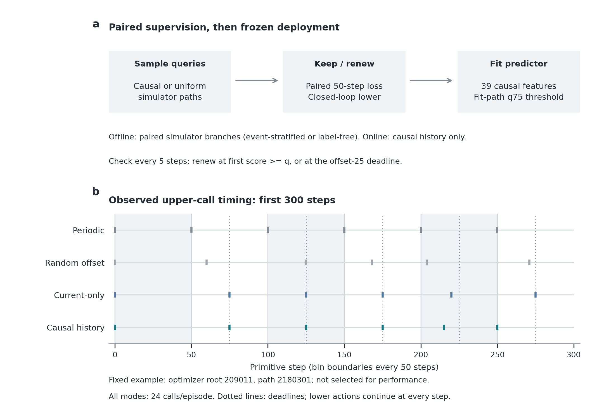
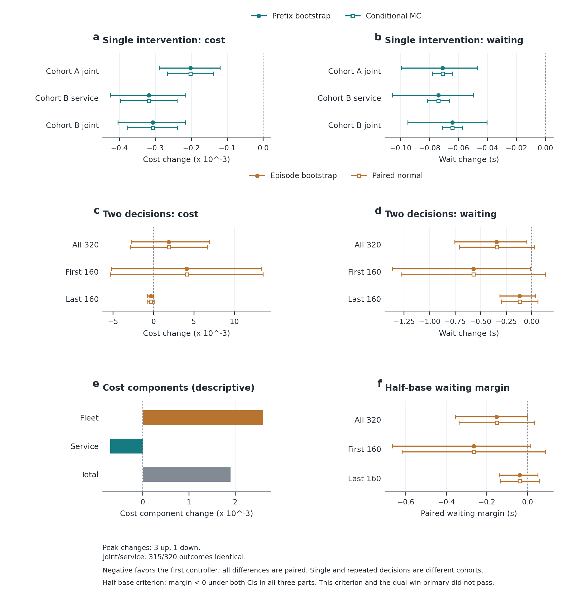

# Plan-Validity-Driven Replanning Under a Fixed Planning Budget

Working manuscript, 2026-11-19. Evidence and source map: [evidence_map.md](evidence_map.md).

## Abstract

A hierarchical controller must decide not only what plan to execute but also when to replace it. We learn when to renew a waypoint from paired simulator rollouts that keep or renew it while holding the lower feedback policy fixed. At deployment, a causal predictor selects the first threshold crossing in each planning bin and a deadline ensures exactly one planner call per bin. Across eight independent PointMaze optimizer roots, this rule reduced episode integrated squared tracking error (ISE) by 0.506 (95% CI 0.408--0.603; 34.94%) and increased return by 40.66 (95% CI 31.55--49.78) over periodic planning at 24 calls. With offline queries drawn from a clock grid instead of hidden event times, the rule reduced ISE by 32.36% relative to periodic timing on 512 fresh paths; no difference from event-stratified acquisition was detected. At matched call counts it also beat a calibrated tracking-distance threshold and two learned timing gates in PointMaze. In a separate eight-root study on a derived Reacher-v5 polygonal tracking task, clock-grid supervision reduced ISE by 5.00% relative to each root's selected fixed clock. A sampling-based subgoal planner illustrates the compute trade-off: fewer calls saved planner time, but scoring overhead offset those savings in the two comparisons that also reduced ISE. The results support supervised renewal timing for the evaluated tracking hierarchies with persistent plans and fast feedback.

## 1. Introduction

Planning and execution in hierarchical control naturally operate on distinct time scales [@sutton1999between; @vezhnevets2017feudal; @nachum2018data]. A fast lower-level controller can continuously reject local disturbances using primitive sensory feedback while a higher-level waypoint or setpoint remains fixed. Periodic replanning makes this division simple to implement, yet allocates identical refresh intervals to plans that remain accurate and plans rendered obsolete by regime shifts or geometric corners. Inspired by metareasoning principles for the value of computation [@russell1991metareasoning] and event-triggered control [@astrom2002comparison; @tabuada2007event; @heemels2012introduction], we study an operational timing question: conditional on the closed-loop lower controller that executes each plan, when is the current plan worth replacing under a strict planner-call budget?

Temporal abstraction in reinforcement learning (RL) already provides mechanisms for variable option lengths, learned termination, and adaptive action repetition [@bacon2017option; @harb2018deliberation; @sharma2017figar; @zhou2020temple; @yu2021taac; @biedenkapp2021temporl]. End-to-end termination learning evaluates timing together with the evolving controller. A scalar tracking-error threshold instead responds to error already present in the state. Separating renewal-timing supervision from policy optimization allows schedules to be evaluated with the same upper and lower weights while estimating the short-horizon effect of refreshing the plan.

We introduce a budgeted plan-validity replanning procedure built on top of standard goal-conditioned RL backends [@schulman2017ppo; @haarnoja2018sac; @fujimoto2018td3] and compatible with sampling-based upper planners [@deboer2005cem; @williams2017mppi]. Given a variable-duration goal-conditioned controller, paired simulator branches replay the same causal prefix twice---once retaining the current waypoint (`keep`) and once invoking the upper planner (`renew`)---while the lower controller acts closed-loop at every primitive step. A lightweight causal predictor is fitted to this short-horizon loss reduction and deployed inside fixed-length planning bins: within each bin, it triggers at the first check score exceeding a held-out quantile threshold \(q\) or at a mid-bin deadline, guaranteeing exactly one upper call per bin.

This paper makes five contributions:

1. **Exact-budget branch-supervised replanning.** We formulate constrained within-bin renewal timing supervised by paired counterfactual `keep`/`renew` rollouts, guaranteeing exact planner-call parity without invoking the upper planner during non-triggered checks, together with an explicit wall-clock compute break-even condition.
2. **Independent PointMaze confirmation and an event-label ablation.** Budgeted renewal timing passes all five preregistered gates on eight fresh PointMaze optimizer seeds. Follow-ups compare against a timing portfolio under shared compute caps and show that queries drawn without event labels can train a trigger that beats periodic and distance-threshold timing.
3. **Matched-call timing comparisons.** On 512 further PointMaze paths, the relational ridge trigger improves tracking relative to native-periodic HRL, a learned binary gate, a tracking-distance threshold, a cost-difference gate, and a raw-input MLP fitted on the same 192 paired queries per root.
4. **Call savings and measured timing costs.** Six PointMaze call budgets separate the effect of changing the call count from the effect of choosing better call times. A CEM subgoal planner experiment reports planner and trigger times separately, showing why better tracking with fewer calls need not lower control time.
5. **Confirmation on a second simulated plant.** On a derived polygonal tracking task using `Reacher-v5` dynamics, the same renewal target and ridge timing rule improve on the selected fixed clock across eight fresh roots. Applicability screens and a separate Transit study distinguish this result from general transfer or guaranteed long-horizon gains.

## 2. Related Work

**Hierarchical RL and temporal abstraction.** Semi-Markov options [@sutton1999between] support decisions at variable intervals. Goal-conditioned hierarchies such as FeUdal Networks [@vezhnevets2017feudal], HIRO [@nachum2018data], HAC [@levy2019hindsight], and causal-effect HRL [@corcoll2022disentangling] separate upper goals from primitive actions. Option-Critic [@bacon2017option] and deliberation-cost options [@harb2018deliberation] learn termination as part of policy optimization. Our timing rule instead estimates the short-horizon effect of renewing a waypoint and constrains the number of upper calls.

**Adaptive decision frequency and action repetition.** Action repetition and methods for continuous control at different time scales study how often to change primitive actions [@sharma2017figar; @tallec2019time; @park2021sar; @biedenkapp2021temporl; @yu2021taac]. Related work encourages smooth feedback actions [@mysore2021caps; @chen2021inertia; @song2023lipsnet; @song2025lipsnetpp]. At the hierarchical level, TEMPLE [@zhou2020temple] uses an end-to-end learned soft gate to mix the previous internal action with a new proposal. Our setting instead holds the waypoint between discrete renewals, with lower feedback acting every \(10\,\mathrm{ms}\) and one upper call per bin.

**Event-triggered control and metareasoning.** Event-triggered and Lebesgue sampling controllers recompute control or model predictive control (MPC) solutions when error or Lyapunov triggers cross a threshold [@astrom2002comparison; @tabuada2007event; @heemels2012introduction; @li2014eventmpc], complementing sampling-based planners such as CEM and MPPI [@deboer2005cem; @williams2017mppi]. Rather than triggering solely on instantaneous subgoal proximity, our predictor estimates the counterfactual value of replanning [@russell1991metareasoning] from causal motion history [@zintgraf2020varibad; @konidaris2011fourier; @wang2026wavelet], paralleling dynamic test-time compute allocation in sequential agents [@paglieri2025learning; @achiam2017cpo].

## 3. Method

### 3.1 Hierarchical control and within-bin timing problem

Let \(h_t\) denote the causal observable history at primitive step \(t \in \{0, \dots, T - 1\}\) with sampling interval \(\Delta t\), and let \(g_t \in \mathbb{R}^d\) denote the active task-space waypoint. An upper planner \(\pi_U(u_t \mid s_t^U)\) outputs a bounded relative subgoal decoded around the current achieved position \(p_t\), while a goal-conditioned lower policy \(\pi_L(a_t \mid s_t^L, g_t)\) outputs physical actuator commands at every primitive step [@todorov2012mujoco]. Both levels are trained with PPO [@schulman2017ppo]: upper transitions accumulate discounted task reward over the realized inter-call duration \(\tau_k\) with bootstrap factor \(\gamma^{\tau_k}\), and lower intrinsic generalized advantage estimation terminates cleanly at realized waypoint boundaries.

For an episode of length \(T = 1200\) steps and nominal bin length \(K\) dividing \(T\), bin \(b \in \{0, \dots, B - 1\}\) spans primitive steps \(bK\) through \((b + 1)K - 1\), giving an exact episode budget of \(B = T / K\) planner calls. The initial call occurs at \(t = 0\). In each subsequent bin \(b \ge 1\), candidate renewal checks occur on a discrete grid of offsets \(\mathcal{O}_K = \{0, S, 2S, \dots, M\}\) with check stride \(S\) and deadline \(M = K / 2\) (for the nominal \(B = 24\) contract, \(K = 50\), \(M = 25\), and \(S = 5\), yielding check offsets \(\{0, 5, 10, 15, 20, 25\}\)). Once a call is made in bin \(b\), further checks in that bin are disabled and the refreshed waypoint is held until the next bin's call, bounding inter-call durations within \([K - M, K + M]\).

### 3.2 Variable-duration versus native-periodic controller training

Evaluating adaptive schedules on a controller trained exclusively at constant \(K\)-step intervals could confound schedule utility with out-of-distribution option lengths, whereas comparing only on variable-duration weights could leave open whether a specialist periodic controller performs better. Each independent optimizer root therefore trains our shared \(\pi_U\) and \(\pi_L\) for 384 PPO iterations using a seeded random-offset schedule (`balanced_jitter`, placing one call per 50-step bin at uniform offsets in \(\{0, \dots, 25\}\)), and in our external-baseline benchmarks we additionally train an independent **native-periodic HRL** controller (`offset = 0` throughout all 384 PPO iterations) under the identical architecture, seed budget, and lexicographic checkpoint-selection rule (negative episode ISE then episode return on disjoint selection paths).

### 3.3 Counterfactual branch supervision and label-free query acquisition

On disjoint branch-fit path seeds per root, a candidate query step \(t_q \notin \mathcal{S}_{\mathrm{prefix}}\) is replayed twice from the identical simulator and history prefix: the `keep` branch retains \(g_{t_q - 1}\), whereas the `renew` branch invokes \(\pi_U\) once at \(t_q\) to issue \(g_{t_q}^{\mathrm{new}}\). Both branches run the closed-loop lower controller \(\pi_L\) for the next \(H = 50\) steps without further upper calls, defining the counterfactual renewal advantage

\[
\Delta_H(h_{t_q}, g_{t_q - 1})
= L_H^{\mathrm{keep}}(h_{t_q}, g_{t_q - 1}) - L_H^{\mathrm{renew}}(h_{t_q}, g_{t_q - 1}),
\qquad
L_H = \Delta t \sum_{j=0}^{H-1} \|e_{t_q + j}\|_2^2,
\]

where \(e_{t_q + j} = y_{t_q + j} - p_{t_q + j}\) is the instantaneous tracking error. Positive \(\Delta_H\) indicates that renewing immediately reduces 50-step tracking ISE relative to keeping the stale waypoint. Exact prefix and causal-feature equality assertions guard every paired query.

We compare three offline query-acquisition protocols at matched query budgets:

1. **Event-stratified acquisition (original confirmation).** Queries are drawn equally across six simulator-defined opportunity classes (three lags after hidden target-regime switches, transient force pulses, reward-irrelevant distractor switches, and calm neutral windows). Event timestamps stratify offline training queries only and never enter features or deployment.
2. **Label-free uniform clock-grid acquisition (*unprivileged-uniform*).** Eligible non-colliding deployment check steps (\(b \in \{1, \dots, 22\}\), offsets \(\{0, 5, 10, 15, 20, 25\}\)) are partitioned into equal temporal strata per fit path, and one query step is sampled deterministically per stratum without inspecting simulator events or state trajectories.
3. **Label-free observable-change acquisition (*unprivileged-observable*).** A single causal rollout records observable target-velocity changes and force norms on the check grid, stratifying high-motion-change, high-force, and calm steps using observable history alone.

### 3.4 Causal predictor fitting and budgeted deployment

The structured renewal-value predictor constructs causal features from normalized plan age \((t - t_{\mathrm{last}}) / 50\), tracking and waypoint error vectors, multi-lag causal target-velocity estimates, measured force norms, and their relational bilinear dot-products (capturing directional alignment between waypoint error, target velocity, and velocity change); no hidden regime label, distractor channel, or future observation is included. Features are standardized on fit data and fitted via ridge regression with an unpenalized intercept, selecting \(\alpha \in \{10^{-2}, 10^{-1}, \dots, 10^{4}\}\) by leave-one-fit-path-out cross-validation MSE.

In the fixed-budget confirmation (\(B = 24\)), the deployment threshold \(q\) is set to the 75th percentile of leave-one-fit-path-out predictions \(\hat{\Delta}_{\mathrm{oof}}\) using fit paths only. When calibrating across general call budgets \(B = T / K\) or external baselines, scalar quantile or threshold parameters are selected on disjoint timing-selection paths per root while holding controller and predictor weights fixed.

```text
Fit and select the variable-duration controller on disjoint training and selection paths.
Acquire paired keep/renew labels on disjoint branch-fit paths (event-stratified or label-free).
Fit causal predictor weights and threshold q without accessing evaluation paths.
For each held-out episode (horizon T, bin length K, deadline M = K/2, stride S):
    Call pi_U at step t = 0.
    In each subsequent bin b = 1, ..., T/K - 1:
        At check offsets 0, S, 2S, ..., M, until one call occurs in bin b:
            Score causal plan and history features (without calling pi_U).
            Invoke pi_U if score >= q or offset == M.
    Execute closed-loop lower policy pi_L at every primitive step t.
```

### 3.5 Predictor and timing comparators

The **generic MLP** uses 25 causal state and history channels (including plan age, physical state, target and waypoint geometry, velocities and force summaries) without relational dot-products. It uses two 32-unit Tanh layers, a scalar output, and AdamW with smooth L1 loss for 220 epochs. Weight decay is selected by leave-one-fit-path-out MSE. Both the MLP and the 39-feature relational ridge use the same clock-grid queries and the same rule for setting the threshold from out-of-fold scores. This comparison changes both the representation and the predictor.

We also compare two timing gates trained without paired renewal labels on the same frozen controller and with the same grid, deadline, and call count at evaluation. The **learned binary gate** uses the 25 channels plus check offset and remaining episode fraction. It learns a stochastic stop decision with a clipped PPO objective using discounted tracking costs over the next 100 steps. Checkpoints and logit cutoffs are selected on timing-selection paths. The **cost-difference gate** fits separate keep and renew cost regressors on transitions from randomized-clock rollouts; it scales shorter observed segments to a 50-step cost and selects a threshold on the predicted keep-minus-renew cost on timing-selection paths. The two gates are inspired by temporal gating and deliberation-cost termination [@zhou2020temple; @harb2018deliberation], but neither reproduces the original end-to-end algorithm. The simple distance gate thresholds current tracking error, \(\lVert y_t-p_t\rVert_2\).

For a cost model in which both schedules pay the same per-call planner cost \(c_{\mathrm{plan}}\) and only the adaptive schedule pays a per-check cost \(c_{\mathrm{check}}\), replacing \(\Delta B\) of \(B\) periodic calls reduces the sum of planner and check time when

\[
\Delta B \cdot c_{\mathrm{plan}} > N_{\mathrm{check}}(B - \Delta B) \cdot c_{\mathrm{check}}
\iff
\frac{c_{\mathrm{plan}}}{c_{\mathrm{check}}} > \frac{N_{\mathrm{check}}(B - \Delta B)}{\Delta B}.
\]

To measure both terms beyond a single actor forward pass, we use a **Cross-Entropy Method (CEM)** subgoal optimizer [@deboer2005cem] warm-started from \(\pi_U\). Each call scores 64 candidates in each of three iterations and uses 12 elites per update. A vectorized NumPy surrogate propagates damped PD dynamics over 25 steps against a causal target forecast. This tests the cost of one iterative planner, not the runtime of a native-dynamics MPC optimizer.



**Figure 1 | Supervision and budgeted deployment.** (a) Offline paired `keep`/`renew` simulator branches (using either event-stratified or label-free clock-grid queries) supervise a 39-feature causal predictor. Online deployment checks every five steps up to the mid-bin deadline, invoking \(\pi_U\) at the first threshold crossing or the deadline. (b) Observed upper-call times over the first 300 steps of the first registered confirmation root and path (`209011` / `2180301`), chosen prospectively rather than for performance. Alternating bands mark 50-step bins; dotted lines mark offset-25 deadlines; \(\pi_L\) acts closed-loop at every step.

## 4. Experimental Design

### 4.1 PointMaze confirmation, portfolio caps, and timing baselines

The PointMaze hidden-regime task drives a continuous target along a U-shaped corridor (\(\Delta t = 0.01\,\mathrm{s}\), \(T = 1200\)) under piecewise-constant hidden speed switches (`-1.25, -0.55, +0.55, +1.25` route-units/s with `0.80--1.60 s` dwells), transient actuator force pulses (`0.04--0.10 s`), and independent distractor shifts. Independent confirmation ran on eight fresh optimizer seeds (`209011`--`209101`), each with disjoint path banks (8 training, 8 checkpoint-selection, 8 branch-fit, and 16 evaluation paths). Four modes share each root's controller on the same evaluation paths: periodic (`offset = 0`), random-offset (`balanced_jitter`), a 170-feature current-only quadratic trigger, and the 39-feature causal-history candidate. Path differences are averaged within each root first; inference uses two-sided 95% Student-\(t\) intervals across the eight paired root means (\(\mathrm{df} = 7\)) [@holm1979multiple; @wilson1927interval]. All five registered lower bounds (ISE gains over periodic, random-offset, and current-only; return gain over periodic; and trained-over-untrained controller learning) must be strictly positive.

On a second eight-root PointMaze cohort (`1981400000`--`1981470000`), frozen follow-ups compared the candidate against selected tracking-distance thresholds (256 paired paths) and a portfolio that selected between learned termination and the best constant clock (512 paired paths). These follow-ups used shared lifecycle caps (10,000 CPU-s at 100 deployments, 6.5M offline steps, 10 ms p99 step latency). The planned all-learned comparison remained on hold because one root's learned termination missed its best clock by `0.01718` selection ISE. On 512 further paired paths (`1982300000`+; 64 paths/root), we compared the 39-feature relational ridge (`ridge_unprivileged`) and 25-channel MLP (`generic_mlp_unprivileged`), each fitted on the same 192 uniform clock-grid queries (eight fit paths, 24 queries/path), against native-periodic HRL, shared periodic and random-offset schedules, the learned binary and cost-difference gates, and a selected tracking-distance threshold. The new comparison matches call counts, not lifecycle compute.

### 4.2 Label-free query ablation, multi-budget Pareto, and CEM wall-clock protocol

Using the eight frozen builds (`1981400000`--`1981470000`) and their eight branch-fit seeds, we fitted uniform and observable-change predictors with 192 paired queries per root and evaluated them on 512 fresh paired paths (`1982100000`+). Across six call budgets \(B \in \{12, 15, 20, 24, 30, 40\}\) (\(K \in \{100, 80, 60, 50, 40, 30\}\), \(M=K/2\), \(S=M/5\)), we selected fixed offsets, tracking-distance thresholds and predictor quantiles separately for each budget on timing-selection paths. The frozen rules were evaluated on 512 fresh paired paths per budget (`1982200000`+; the same paths across budgets, 15,360 episodes). The CEM study reuses the clock-grid predictor fitted with the original planner and recalibrates its threshold and the distance threshold with CEM on four selection paths per root and budget. We record ISE and planner, score-check and lower inference wall times on another 256 paired paths per budget (`1982400000`+).

### 4.3 Second physical plant confirmation and applicability screens

To test the same renewal target and fitting recipe on a different simulated plant, we built a polygonal tracking task using MuJoCo's torque-controlled 2-DOF `Reacher-v5` dynamics (\(\Delta t=0.01\,\mathrm{s}\), frame skip 1, \(T=1200\)). The target follows the sides of a pentagon, with \(72^\circ\) changes of direction at vertices and hidden signed speed modes of `-1.35, -0.65, +0.65, +1.35` edges/s. Across eight fresh optimizer roots (`1983100000`--`1983170000`), we trained variable-duration and native-periodic controllers for 384 PPO iterations each, acquired 192 clock-grid query pairs per root (eight paths, 24 pairs/path), and evaluated nine methods on 64 held-out paths per root without excluding roots. The ridge and MLP cutoffs use fit-path predictions; the fixed-clock and other gate choices use disjoint timing-selection paths.

We report separate development screens on smooth-ellipse Reacher (24 paired paths/root) and LQR-stabilized cart-pole position tracking (24 paths/configuration plus a 32-path crossed factorial). These compare waypoint freshness at fixed clocks and event timing against the best fixed clock and rotated offsets. They are not a controlled comparison of trajectory geometries. Appendix A reports a separate Transit study of repeated decisions.

## 5. Results

### 5.1 Independent PointMaze confirmation and portfolio benchmarks

All five preregistered confirmation gates passed on the eight independent optimizer roots (Table 1; Figure 2). Every individual root showed positive ISE and return gains over periodic planning. Pooled mean episode ISE was `1.447072` under periodic timing, `1.549716` under random offsets, `1.202303` under the 170-feature current-only trigger, and `0.941530` under the 39-feature causal-history trigger (a 34.94% reduction relative to periodic timing). Every mode executed exactly 24 planner calls per episode; the causal-history trigger placed `13.1953` pre-deadline calls on average and evaluated `84.1875` linear score checks per episode (range 48--120). The preceding eight-root development cohort independently passed the same gates (ISE gain `0.396372`, 95% CI `[0.275784, 0.516959]`; return gain `30.770657`, 95% CI `[21.111415, 40.429899]`).

**Table 1. Frozen independent-seed PointMaze confirmation.** Positive contrasts favor the causal-history candidate or the trained controller. Intervals are two-sided 95% Student-\(t\) bounds across eight paired optimizer-root means (\(\mathrm{df} = 7\)).

| Registered contrast | Mean | 95% CI |
| --- | ---: | --- |
| Fixed - candidate episode ISE | 0.505541 | [0.408443, 0.602640] |
| Random-offset - candidate episode ISE | 0.608186 | [0.570111, 0.646260] |
| Current-only - candidate episode ISE | 0.260773 | [0.152216, 0.369331] |
| Candidate - fixed episode return | 40.662456 | [31.548406, 49.776506] |
| Untrained - trained controller ISE | 20.862987 | [15.939428, 25.786547] |


**Figure 2 | Independent-seed PointMaze confirmation.** (a) Paired root ISE advantages over periodic (primary), random-offset, and current-only timing; (b) episode return advantage over periodic timing; (c) controller-learning verification comparing untrained and trained controller ISE; (d) mean planner calls and trigger score checks per episode. Teal dots denote the eight optimizer-root means (16 evaluation paths each); black diamonds and bars denote grand means and 95% Student-\(t\) intervals (\(\mathrm{df} = 7\)).

On the lifecycle-capped cohort, the frozen rule reduced mean ISE by 7.28% relative to per-root selected tracking-distance thresholds on 256 diagnostic paths (`1.01091` versus `1.09029`, gain `0.07938`, 95% CI `[0.03008, 0.12868]`, 8/8 roots), and outperformed both the distance threshold by 5.81% (7/8 roots) and the learned-termination/best-clock portfolio by 21.56% (8/8 roots) on 512 subsequent paired paths under shared CPU, step, and `10 ms` p99 latency caps (realized max p99 `1.78 ms`; Table 2). A capacity-matched 91-parameter quadratic ablation on 512 paths further showed that \(100\,\mathrm{ms}\) target-velocity and force-RMS history reduced ISE by 6.44% over instantaneous features (`1.14792` versus `1.22699`, 95% CI `[0.01870, 0.13942]`, 8/8 roots), whereas a \(500\,\mathrm{ms}\) velocity window degraded ISE by 5.85% (`1.21502`).

**Table 2. PointMaze timing portfolio and distance threshold.** Positive gains favor the plan-validity timing rule (mean ISE: 0.99934) across 512 paired fresh paths on eight frozen controller builds.

| Comparator | Episode ISE (Stage9: 0.99934) | Paired root ISE gain [nominal 95% CI] | Relative gain |
| --- | ---: | --- | ---: |
| Selected distance threshold | 1.06097 | 0.06163 [0.01980, 0.10345] | 5.81% |
| Selected termination or clock | 1.27402 | 0.27467 [0.19309, 0.35625] | 21.56% |

### 5.2 Clock-grid query acquisition without event labels

Uniform clock-grid queries (mean ISE `1.01228`) improved ISE by 32.36% over periodic, 36.59% over random offsets, and 6.42% over the selected tracking-distance threshold on 512 new paired paths; all eight roots favored the uniform predictor on these comparisons (Table 3; Figure 3a). Against event-stratified supervision (`1.01512`), the paired difference was `0.00284` (95% CI `[-0.02368, 0.02936]`). The interval includes zero and no noninferiority margin was set. Observable-change sampling also improved ISE versus periodic (`30.77%`) and distance (`4.21%`, 95% CI `[0.02998, 0.06121]`, 8/8 roots).

**Table 3. Label-free renewal-query acquisition at \(B = 24\) calls.** Positive contrasts favor the unprivileged predictor (*unprivileged-uniform* mean ISE: `1.01228`, return: `944.15`) across eight frozen roots (512 paired paths).

| Contrast (`Comparator - candidate` ISE) | Paired ISE gain | 95% CI | Relative gain | Favorable roots |
| --- | ---: | --- | ---: | ---: |
| Periodic - unprivileged uniform | 0.48437 | [0.45359, 0.51516] | 32.36% | 8/8 |
| Random-offset - unprivileged uniform | 0.58411 | [0.54480, 0.62343] | 36.59% | 8/8 |
| Distance threshold - unprivileged uniform | 0.06950 | [0.04608, 0.09292] | 6.42% | 8/8 |
| Event-stratified - unprivileged uniform | 0.00284 | [-0.02368, 0.02936] | 0.28% | 5/8 |
| Distance threshold - unprivileged observable | 0.04560 | [0.02998, 0.06121] | 4.21% | 8/8 |

### 5.3 PointMaze timing and predictor comparisons

On 512 paired paths, the variable-duration controller run periodically achieved `1.47639` ISE, versus `1.56950` for the separately trained native-periodic controller. The clock-grid ridge achieved `0.99422` ISE and `945.89` return, improving ISE over native-periodic HRL by 36.65% (`0.57529`, 95% CI `[0.50935, 0.64123]`) and over the learned binary gate by 33.80%. It improved over the cost-difference gate by 4.38% (`0.04550`, 95% CI `[0.02553, 0.06546]`, path halves `+4.29%` and `+4.46%`). The MLP reduced ISE relative to native-periodic, shared periodic and learned binary timing. At the same 192 paired queries, ridge reached 21.05% lower ISE than the MLP (`0.26505`, 95% CI `[0.16322, 0.36689]`, 8/8 roots). Table 4 and Figure 4a report a difference between complete predictors at one query budget, not an isolated effect of dot-products or a sample-efficiency curve.

**Table 4. PointMaze timing and predictor comparisons (\(B=24\), 512 paired paths).** Positive gains favor the clock-grid ridge (mean ISE: `0.99422`, return: `945.89`). Intervals use the eight paired root means.

| Comparator | Comparator ISE | Paired ISE gain [95% CI] | Relative gain | Roots |
| --- | ---: | --- | ---: | ---: |
| Native-periodic HRL | 1.56950 | 0.57529 [0.50935, 0.64123] | 36.65% | 8/8 |
| Shared periodic | 1.47639 | 0.48217 [0.44477, 0.51958] | 32.66% | 8/8 |
| Learned binary gate | 1.50176 | 0.50754 [0.43627, 0.57881] | 33.80% | 8/8 |
| Distance threshold | 1.06802 | 0.07380 [0.04960, 0.09801] | 6.91% | 8/8 |
| Cost-difference gate | 1.03971 | 0.04550 [0.02553, 0.06546] | 4.38% | 8/8 |
| Generic MLP (raw 25-ch) | 1.25927 | 0.26505 [0.16322, 0.36689] | 21.05% | 8/8 |

### 5.4 Tracking across call budgets and measured CEM costs

Across all six planner-call budgets \(B \in \{12, 15, 20, 24, 30, 40\}\), label-free plan-validity timing achieved strictly lower episode ISE than periodic, best-clock, and per-budget recalibrated distance thresholds, with positive two-sided 95% intervals at every budget (Table 5; Figure 3b,c). Relative ISE reductions ranged from 27.85% to 31.47% over periodic planning (8/8 roots at every budget) and from 5.56% to 9.25% over recalibrated distance cuts. Cross-budget comparisons confirm substantial call compression (Figure 3d): **20 adaptive calls** (`1.31047`) beat **24 periodic calls** (`1.49962`) by `0.18914` (95% CI `[0.12310, 0.25519]`; 12.61% lower ISE on 8/8 roots with 16.7% fewer calls), and **24 adaptive calls** (`1.02774`) beat **30 periodic calls** (`1.23319`) by `0.20545` (95% CI `[0.13924, 0.27166]`; 16.66% lower ISE on 8/8 roots with 20.0% fewer calls).

**Table 5. Multi-budget planning Pareto frontier across 512 fresh paired paths per budget.** Distance thresholds and predictor quantiles are calibrated on disjoint selection paths separately at each budget \(B\).

| Calls \(B\) (bin \(K\)) | Periodic ISE | Distance cut ISE | Unprivileged ISE | Gain vs. distance [95% CI] | Gain vs. periodic |
| --- | ---: | ---: | ---: | --- | ---: |
| 12 (\(K = 100\)) | 3.08421 | 2.39868 | 2.22519 | 0.17350 [0.07589, 0.27110] | 27.85% |
| 15 (\(K = 80\)) | 2.54477 | 1.93024 | 1.80257 | 0.12767 [0.05736, 0.19798] | 29.17% |
| 20 (\(K = 60\)) | 1.85168 | 1.38767 | 1.31047 | 0.07720 [0.01843, 0.13597] | 29.23% |
| 24 (\(K = 50\)) | 1.49962 | 1.10141 | 1.02774 | 0.07367 [0.04158, 0.10576] | 31.47% |
| 30 (\(K = 40\)) | 1.23319 | 0.94373 | 0.86969 | 0.07405 [0.03510, 0.11299] | 29.48% |
| 40 (\(K = 30\)) | 0.90651 | 0.70179 | 0.63689 | 0.06489 [0.02313, 0.10666] | 29.74% |


**Figure 3 | Query acquisition and call budgets.** (a) At \(B=24\), the clock-grid trigger improves on periodic and tracking-distance timing. The interval against event-stratified queries includes zero. (b) Episode ISE at six call counts. (c) Paired gains over separately calibrated tracking-distance thresholds. (d) ISE contrasts when using fewer calls than periodic timing; the 30-versus-40 contrast is inconclusive.

With the CEM planner, clock-grid timing had `23.83%`--`32.67%` lower ISE than periodic timing at matched call counts. It had lower point estimates than the distance threshold at all six budgets, but the intervals crossed zero at 15 and 24 calls (Table 6). In the cross-budget tests, 20 adaptive calls beat 24 periodic calls by 15.82% ISE (`0.22821`, 95% CI `[0.17814, 0.27827]`), and 24 adaptive calls beat 30 periodic calls by 13.99% (`0.16341`, `[0.07660, 0.25022]`). They saved `18.38 ms` (`[11.12, 25.65]`) and `31.08 ms` (`[21.49, 40.66]`) of planner time per episode, respectively. Including scoring, the signed savings were `-22.81 ms` (`[-37.10, -8.53]`) and `-35.50 ms` (`[-52.53, -18.46]`): both were slower. For 20 versus 30 calls, the upper-loop savings were `10.28 ms` (`[-5.87, 26.42]`), and the ISE contrast also crossed zero. The 24-call distance threshold improved ISE and saved `32.06 ms` (`[19.57, 44.55]`) of planner-plus-score time relative to 30 periodic calls. These are eight-root paired intervals (Figure 4d).

Adding recorded lower inference time, the signed savings for the two accuracy-positive ridge comparisons were `-22.27 ms` (95% CI `[-101.00, 56.45]`) and `-13.30 ms` (`[-81.62, 55.02]`), respectively. This sum excludes environment dynamics and untimed control operations. Neither comparison established a net speedup.

**Table 6. CEM subgoal planner accuracy and wall-clock decomposition (256 paired paths/budget).** Columns report episode ISE and per-episode wall-clock times (ms) for CEM planning (`Plan ms`) and Python trigger checks (`Check ms`).

| Calls \(B\) | Periodic ISE | Distance ISE | Unprivileged ISE | Gain vs. periodic [95% CI] | Plan ms | Check ms |
| --- | ---: | ---: | ---: | --- | ---: | ---: |
| 12 | 3.05587 | 2.59857 | 2.32774 | 0.72813 [0.60337, 0.85288] | 50.22 | 22.70 |
| 15 | 2.51956 | 1.82694 | 1.74231 | 0.77725 [0.66598, 0.88852] | 62.93 | 32.55 |
| 20 | 1.80377 | 1.35345 | 1.21456 | 0.58921 [0.50519, 0.67322] | 87.57 | 41.20 |
| 24 | 1.44276 | 1.08649 | 1.00496 | 0.43781 [0.35064, 0.52498] | 107.97 | 66.57 |
| 30 | 1.16837 | 0.85759 | 0.79823 | 0.37014 [0.32450, 0.41578] | 138.30 | 74.00 |
| 40 | 0.81310 | 0.63007 | 0.54905 | 0.26405 [0.22296, 0.30514] | 178.02 | 105.35 |


**Figure 4 | Timing baselines, second-plant confirmation, and CEM costs.** (a,b) Paired root ISE gains over timing and predictor baselines in PointMaze and polygonal Reacher. (c) CEM planner time alone versus episode ISE across the six call budgets. (d) Cross-budget savings in planner time alone and planner plus scoring time; positive favors the first schedule. Neither quantity includes lower control.

### 5.5 Second physical plant confirmation and structural applicability boundaries

On polygonal Reacher (512 paired paths, eight fresh roots), the clock-grid ridge (`4.48852` ISE, return `703.08`) had lower episode ISE than random offsets (6.44%), the per-root selected fixed clock (5.00%, 8/8 roots), shared periodic timing (4.27%), and the learned binary gate (3.86%). The paired nominal 95% intervals for ISE and return favored ridge in those four comparisons (Table 7; Figure 4b). The generic MLP (`4.57433` ISE) also improved on the selected clock (`0.15054`, 95% CI `[0.06006, 0.24101]`), shared periodic timing (`0.11419`, `[0.00610, 0.22228]`), and the learned binary gate (`0.09452`, `[0.00184, 0.18721]`).

**Table 7. Independent eight-seed confirmation on 2-DOF `Reacher-v5` polygonal tracking (\(B = 24\), 512 paired paths).** Positive contrasts favor label-free relational plan-validity ridge (mean ISE: `4.48852`, return: `703.08`) across all eight unfiltered roots.

| Comparator | Comparator ISE | Paired ISE gain [95% CI] | Relative gain | Roots |
| --- | ---: | --- | ---: | ---: |
| Random-offset | 4.79737 | 0.30885 [0.09895, 0.51874] | +6.44% | 7/8 |
| Best fixed clock | 4.72486 | 0.23634 [0.07881, 0.39387] | +5.00% | 8/8 |
| Shared periodic | 4.68852 | 0.20000 [0.03472, 0.36528] | +4.27% | 6/8 |
| Learned binary gate | 4.66885 | 0.18033 [0.01249, 0.34817] | +3.86% | 6/8 |
| Distance threshold | 4.50019 | 0.01166 [-0.05165, 0.07498] | +0.26% | 6/8 |
| Cost-difference gate | 4.44330 | -0.04522 [-0.15268, 0.06224] | -1.02% | 5/8 |
| Native-periodic HRL | 4.55387 | 0.06534 [-1.09412, 1.22481] | +1.43% | 4/8 |

The Reacher contrasts against the distance threshold, cost-difference gate and separately trained native-periodic HRL were inconclusive, not equivalent (Table 7). Unlike in PointMaze, the cost-difference gate had lower ISE than ridge at the point estimate. Waypoint freshness, checked on timing-selection paths, averaged `+18.24%`. In a descriptive split, the six roots with freshness gains above 5% had mean ISE `4.1908` for ridge and `4.4544` for shared periodic; on the other two roots, shared-controller timing rules spanned `5.38`--`5.41` ISE. All eight roots stay in the main comparisons. This split does not establish a predictive threshold or a causal explanation for the task differences.

**Table 8. Structural applicability screens.** Positive entries denote relative reductions in whole-episode ISE versus the comparator on paired development paths.

| Frozen root or configuration | Current vs previous waypoint | Event vs selected clock | Event vs rotated offsets |
| --- | ---: | ---: | ---: |
| Reacher 1972210000 | +12.30% | -0.22% | +0.30% |
| Reacher 1972220000 | +6.02% | +1.99% | +1.41% |
| Cart-pole, LQR position weight 10 | -8.30% | +5.13% | +5.03% |
| Cart-pole, LQR position weight 30 | +4.41% | +10.03% | +9.77% |

In smooth-ellipse Reacher, current waypoints improved tracking in both frozen roots, but the tested event alignment did not show a reliable gain over either timing control. In cart-pole, visible-command timing beat both controls in each configuration, while waypoint freshness reversed sign with the lower controller. The reversal persisted in a crossed 32-path comparison at both offsets (freshness shift `0.02458`, 95% CI `[0.02299, 0.02618]`). These screens separate two questions: whether a fresh waypoint helps, and whether shifting a call helps.

## 6. Discussion and Limitations

**What the timing rule learns.** Pairing `keep` and `renew` on the same replayed path controls the exogenous inputs in that contrast. Clock-grid sampling removes the need for hidden event annotations, not for paired loss targets. The fixed-budget benefit transfers to the derived polygonal Reacher task against fixed-clock controls, not to every timing baseline. The rollout loss difference is a training target, not a guarantee about where to spend the bin's single call.

**Limitations.** Branch supervision uses a resettable simulator and 192 paired queries per root in the clock-grid studies; prefix replay, fitting and scoring add work beyond planner calls. Our CEM comparison measures planner, scoring and lower-inference costs, not equal lifecycle compute or end-to-end speed. The 50-step target does not account for all downstream decisions. Appendix A shows why repeated control needs a separate episode test when rare events can dominate cost.

## 7. Reproducibility

The [artifact manifest](artifact_files.txt) lists the compact analysis inputs, protocols and selected experiment code. `make -C paper reproduce` rebuilds the evidence, five figures, CSV source tables and PDF from saved results, and checks their numerical transcription and links without a simulator or scheduler. The bundle reproduces analysis and presentation; it does not include the caches and checkpoints needed to rerun training. See the [rebuild instructions](README.md) and [evidence map](evidence_map.md).

## 8. Conclusion

Paired keep/renew supervision improves when a tracking hierarchy spends a fixed number of planner calls. The benefits persist without hidden event labels in PointMaze and extend to selected fixed-clock comparisons on polygonal Reacher. Call reductions are repeatable in the reported PointMaze comparisons, but realized compute depends on scoring overhead. These results support a timing rule for the tested planning and execution setups rather than an improvement to the underlying RL optimizer.

## Appendix A. Repeated-Decision Boundary in Transit Timetable Control

To examine whether validated single-intervention value guarantees full-episode improvement under repeated discrete resource constraints, we report an auxiliary boundary study in a native bidirectional bus corridor simulator. Unlike within-bin waypoint timing, this domain uses finite-Monte-Carlo action selection (`P8` proposals screened on `S8` rollouts) to choose timetable headways above a frozen lower holding controller.

In two independent 400-prefix single-intervention cohorts, the joint fleet-plus-service selector reduced total cost and passenger waiting relative to raw control under both prefix-bootstrap and conditional-Monte-Carlo 95% intervals. The service-only selector was also evaluated in the second cohort and reduced both outcomes. The joint selector did not show extra cost improvement over service-only (Table 9; Figure 5a,b). In a subsequent 320-scene complete-episode evaluation with interventions at callbacks 8 and 9 of 44, service-only total cost increased at the point estimate (`+1901.331 x 1e-6`), the paired normal waiting interval crossed zero, and the preregistered 50% base-wait retention criterion failed (Table 10; Figure 5c--f). Four discrete peak-fleet changes (three increases, one decrease) accounted for the excess fleet cost. The Transit selector is a different algorithm, so this result illustrates a local-to-episode boundary rather than a failed replication of the timing rule.

**Table 9. Native Transit single-intervention outcomes.** Negative values favor the first controller; cost and waiting-minute contrasts are scaled by \(10^6\).

| Study / contrast / endpoint | Mean | Prefix CI95 | Conditional MC CI95 |
| --- | ---: | --- | --- |
| Stage298 / joint - raw / cost | -202.006 | [-288.844, -119.627] | [-265.551, -138.460] |
| Stage298 / joint - raw / wait | -1182.737 | [-1658.035, -781.291] | [-1299.168, -1066.305] |
| Stage301 / service-only - raw / cost | -318.120 | [-424.992, -215.424] | [-396.701, -239.539] |
| Stage301 / service-only - raw / wait | -1230.467 | [-1757.211, -825.834] | [-1357.549, -1103.385] |
| Stage301 / joint - raw / cost | -307.139 | [-403.590, -216.799] | [-376.580, -237.698] |
| Stage301 / joint - raw / wait | -1070.902 | [-1583.164, -673.425] | [-1185.750, -956.054] |
| Stage301 / joint - service-only / cost | 10.981 | [-38.466, 60.105] | [-26.841, 48.802] |
| Stage301 / joint - service-only / wait | 159.565 | [82.814, 250.561] | [110.377, 208.754] |

**Table 10. Complete-episode Transit boundary (two consecutive interventions across 320 scenes).** Negative values favor the first controller (\(10^6\) scaling).

| Contrast / endpoint | Mean | Episode bootstrap CI95 | Paired normal CI95 |
| --- | ---: | --- | --- |
| service-only - raw / cost | 1901.331 | [-2729.400, 6937.962] | [-2856.632, 6659.294] |
| service-only - raw / service component | -702.835 | [-1497.065, -120.823] | [-1414.375, 8.704] |
| service-only - raw / wait | -5706.250 | [-12519.141, -787.422] | [-11818.256, 405.756] |
| joint - service-only / cost | 28.572 | [-5.247, 84.056] | [-19.407, 76.551] |



**Figure 5 | Local Transit gains and the repeated-decision episode boundary.** (a,b) Single-intervention cost and waiting reductions on two 400-prefix cohorts (`Stage298` = Cohort A, `Stage301` = Cohort B). (c,d) Complete-episode cost and waiting contrasts across 320 paired two-decision scenes and their 160-scene halves. (e) Descriptive decomposition showing discrete peak-fleet penalties outweighing continuous service savings. (f) Paired half-base waiting retention margin \(\Delta W_{\mathrm{service}} - 0.5\,\Delta W_{\mathrm{base}}\), where negative upper bounds under both CIs in all parts were required and not met.
