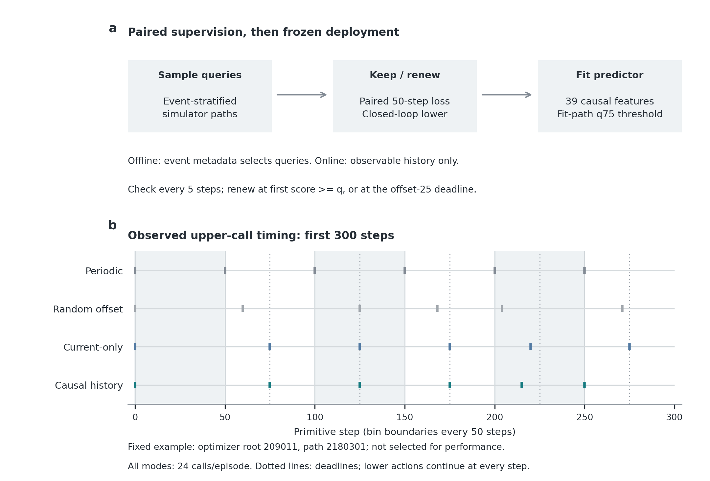
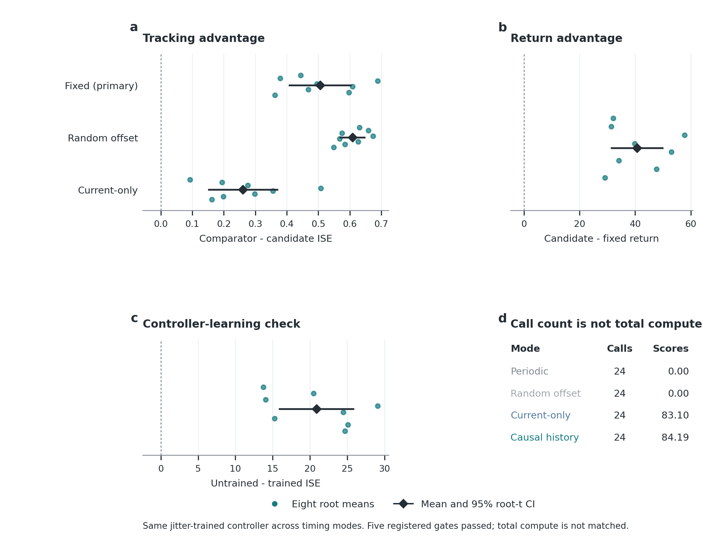
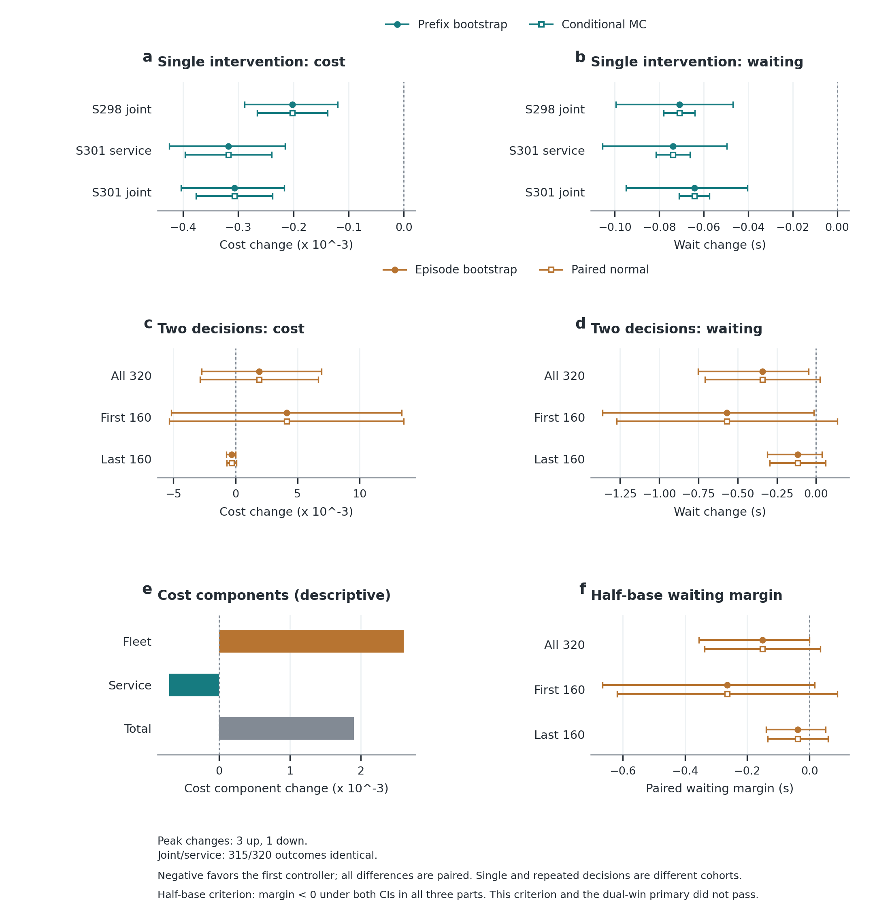

# Plan-Validity-Driven Replanning Under a Fixed Planning Budget

Working manuscript, 2026-10-22. Evidence and source map: [evidence_map.md](evidence_map.md).

## Abstract

A hierarchical controller must decide not only what plan to execute but also
when to replace it. We study whether a prediction of the value of renewing the
current plan can improve that timing without increasing the number of planner
calls. A goal-conditioned controller is first trained with variable option
durations. Paired simulator branches then supply supervision for keeping or
renewing its current waypoint. A predictor using causal plan-state and motion
history features triggers the first threshold crossing within each planning
bin, with a deadline that preserves exactly one call per bin. In a frozen
PointMaze hidden-regime confirmation with eight independent optimizer seeds,
the trigger reduced episode tracking-error integral by 0.506 (95% CI
0.408-0.603) and increased return by 40.66 (31.55-49.78) relative to periodic
planning, with 24 planner calls in every episode. Separate Transit studies
reproduced single-intervention service and cost gains, but a subsequent
320-scene two-decision evaluation did not confirm joint cost/wait improvement
or added fleet-critic value. The evidence establishes fixed-call-budget timing
utility within the PointMaze task family and identifies a boundary between
local decision value and repeated-decision performance. The results identify
a task-bounded role for supervised renewal value and expose the cost-risk
barrier to extending local decision gains to repeated control.

## 1. Introduction

Planning and execution operate on different clocks. A lower controller can
continue to respond to physical feedback while a higher-level waypoint remains
unchanged. Periodic planning makes this division simple, but assigns the same
refresh schedule to a useful plan and an obsolete one. The decision studied
here is whether the present plan is worth replacing, conditional on the
controller that will execute the replacement.

Temporal abstraction already supports learned termination, action repetition
and adaptive high-level decision frequency [@sutton1999between;
@bacon2017option; @sharma2017figar; @zhou2020temple]. Our question is narrower:
can direct supervision of a keep-versus-renew value difference improve the
allocation of a fixed number of upper calls? Separating this timing decision
from controller learning makes it possible to compare schedules using exactly
the same trained upper and lower policies.

The proposed procedure learns an operational plan-validity predictor. Its
target is a paired short-horizon tracking loss difference, obtained by replaying
the same simulator prefix while either retaining the waypoint or requesting
a new one. At deployment, the predictor uses only current and past observations.
It can move a call within a predefined bin but cannot add calls. Full-episode
evaluation tests whether the local supervision remains useful after the
resulting decisions change the states subsequently visited.

The study makes three contributions. First, it specifies a reproducible
branch-supervised timing rule with an exact planner-call constraint. Second,
it reports a frozen independent-seed PointMaze confirmation against periodic,
random-offset and current-only timing controls. Third, it separates this result
from a native Transit extension in which single-intervention improvements did
not satisfy the registered repeated-decision criterion. The historical
frequency-based research motivated the question; the tested advance is the
use of plan-dependent renewal value to choose decision times.

## 2. Related Work

**Temporal abstraction.** Options formalize extended actions, and Option-Critic
learns intra-option policies and termination conditions [@sutton1999between;
@bacon2017option]. Our controller is trained with semi-Markov upper transitions;
the added timing predictor is fitted afterwards from paired branches.

**Adaptive decision timing.** FiGAR learns action repetition lengths, TEMPLE
adapts high-level decision frequency, and TAAC chooses between a previous and
a newly proposed physical action [@sharma2017figar; @zhou2020temple;
@yu2021taac]. These are direct conceptual neighbors. Here the executed lower
action remains closed-loop at every primitive step, while the upper waypoint
refresh is restricted to one call per bin. The present comparisons isolate
timing effects under a shared trained controller.

**Allocating planning computation.** Learning when to plan also appears in
language-model agents, including a supervised-plus-RL approach to dynamic
planning in Crafter [@paglieri2025learning]. Our setting uses continuous-control
waypoints, paired simulator supervision and a fixed call-count contract. The
present comparisons establish schedule utility, not a general advantage in
test-time compute allocation.

## 3. Method

### 3.1 Controller and timing problem

Let h_t denote the observable history at primitive time t, and let g_t be the
current waypoint. An upper policy pi_U produces a relative state-space goal;
a goal-conditioned lower policy pi_L produces every physical actuator action.
Both policies are learned with PPO [@schulman2017ppo]. An upper transition spans
the actual interval between waypoint changes, and lower intrinsic GAE ends at
the realized waypoint boundary.

The episode has T = 1200 steps of 0.01 seconds. With K = 50, bin b contains
steps bK through (b+1)K-1. The timing rule must make exactly one upper call per
bin. The first call occurs at step zero. Subsequent bins allow calls only at
offsets {0, 5, 10, 15, 20, 25}; the waypoint is held until the next actual call.
The variable inter-call durations are therefore 25-75 steps. This is a
constrained within-bin timing problem, not an unconstrained termination process.

### 3.2 Variable-duration controller training

Each optimizer seed uses eight controller-training paths and eight separate
checkpoint-selection paths. Training lasts 384 iterations. A seeded
random-offset schedule makes one upper call per bin, with offsets from zero
to 25, so the controller encounters variable durations before trigger fitting.
The selected upper/lower weights are then frozen across all four timing modes.
The controller has 267,018 parameters; it uses a 0.64-second observation history,
a 0.50-second nominal upper period and a 0.04-second fast feature timescale.

### 3.3 Paired renewal supervision

On eight separate branch-fit paths, a query is replayed twice from the same
prefix: keep retains the current waypoint; renew invokes the upper policy
once at the query. Both branches run the lower controller for the same next
H = 50 steps without further upper calls. The target is

\[
\Delta_H(h_t,g_t)
= L_H^{\mathrm{keep}}(h_t,g_t)-L_H^{\mathrm{renew}}(h_t,g_t),
\qquad
L_H = 0.01\sum_{j=0}^{H-1}\|e_{t+j}\|_2^2,
\]

where e is the task tracking error. A positive value favors renewing for this
branch horizon. Prefix and feature equality checks pair the interventions;
the lower controller continues to respond to the evolving physical state.

Each path supplies four queries from each of six simulator-defined classes:
three lags after a regime change, a force pulse, a distractor change and a
matched neutral opportunity. This gives 192 paired queries per optimizer seed.
Event information stratifies offline query acquisition, including neutral-window
selection. It is excluded from predictor inputs and deployment decisions.

### 3.4 Causal-history predictor

The candidate uses 39 features of plan age, tracking and waypoint geometry,
observed target velocities over 1/10/25/50-step lags, force magnitude, and their
fixed interactions. The current-only control uses 170 quadratic features
constructed from 17 current state/plan variables. Both models standardize
features using fit data and solve ridge regression with an unpenalized
intercept. The ridge coefficient is selected by leave-one-fit-path-out MSE
from {0.01, 0.1, 1, 10, 100, 1000, 10000}.

For the selected coefficient, leave-one-fit-path-out predictions determine the
75th-percentile threshold q. This threshold is an empirical timing parameter,
not a calibrated probability or a certificate that renewal has positive value.
Evaluation paths do not select coefficients, features or thresholds.

### 3.5 Budgeted deployment

At an unused call opportunity in a bin, the predictor scores the current
observable history and plan. The upper policy is called at the first score
at least q, or at offset 25 if no earlier opportunity passes. Computing a
predictor score does not call the upper policy. The lower policy acts at every
step, including while the timing rule is waiting.

```text
Fit and select the variable-duration controller on disjoint path sets.
Fit the renewal predictor and its threshold on branch-fit paths only.
Freeze controller weights, predictor and threshold.
For each held-out episode:
    Call the upper policy at step zero.
    In each later 50-step bin:
        At offsets 0, 5, 10, 15, 20, 25, until one call occurs:
            Score the currently observed plan and history.
            Renew if score >= threshold or offset == 25.
    Execute the lower policy on every primitive step.
```

**Budget property.** Every bin makes at most one call because later checks
are disabled after renewal. Every bin makes at least one because offset 25
is a mandatory deadline. Thus every complete episode makes exactly T/K = 24
calls. This scheduling property does not imply optimal timing or lower total
computational cost.



**Figure 1 | Supervision and budgeted deployment.** (a) Event-stratified offline
queries provide paired 50-step keep/renew losses for the 39-feature predictor.
Deployment checks every five steps within the allowed offset window, with one
upper call at the first threshold crossing or the offset-25 deadline. (b) The
first 300 steps of the first registered confirmation root/path (209011/2180301)
show actual saved upper-call times for all four modes; this example was not
chosen for performance. Shading alternates 50-step bins; dotted lines mark
deadlines after the initial bin. Lower actions remain closed-loop every step.
All complete episodes have 24 upper calls. [Source data](figures/fig1_budgeted_replanning_source.csv).

## 4. Experimental Design

### 4.1 Independent PointMaze confirmation

The hidden-regime task combines moving targets, physical force pulses and
distractor observations. The frozen algorithm was developed before confirming
it on optimizer roots 209011, 209023, 209037, 209049, 209061, 209073, 209089
and 209101. Each root uses 8 training, 8 selection, 8 branch-fit and 16
trigger-evaluation path seeds. All 320 path seeds across these roles are
distinct and disjoint from development.

Four timing modes share a root's trained controller and its evaluation paths:
periodic calls at bin starts, seeded random-offset calls, the current-only
trigger, and the causal-history candidate. The primary endpoint is fixed minus
candidate episode integrated squared tracking error (ISE). Four additional
registered gates test ISE against random-offset and current-only controls,
return against fixed timing, and controller learning against initialization.

For each contrast, path differences are averaged within a root; the eight
root means supply the two-sided 95% Student-t interval with seven degrees of
freedom. The joint registered decision requires all five lower bounds to be
positive. The 128 evaluation paths and 512 paired-mode rollouts do not replace
the eight optimizer seeds as the independent units. Development and
confirmation estimates remain separate.

### 4.2 Native Transit boundary study

Transit evaluates a different, finite-Monte-Carlo action-selection procedure.
Independent P8 proposal and S8 screening futures support a service-aware
timetable intervention with a frozen lower controller. It searches alternative
timetable actions, rather than only timing a call to the PointMaze policy.
It therefore tests an extension of the decision-value idea, not the same
algorithm in a second domain.

Single-intervention studies use independent evaluation futures after actions
and matching weights are sealed. Prefix-bootstrap intervals quantify scenario
variation; paired conditional-MC intervals quantify future sampling at those
prefixes. The subsequent two-decision study evaluates 320 fresh complete
scenes, with four paired controllers, at upper callbacks 8 and 9. Each
controller rebuilds its second state and P8/S8 menus after its own executed
first action. Both its stratified bootstrap and paired normal intervals use
complete scene/episode units; neither is a conditional-future MC interval.

## 5. Results

### 5.1 Plan-validity timing improved held-out PointMaze control

All five registered confirmation gates passed (Table 1). Every optimizer root
had positive candidate-versus-fixed ISE and return effects. Mean episode ISE
was 1.447072 with fixed timing, 1.549716 with random offsets, 1.202303 with
the current-only trigger and 0.941530 with the causal-history trigger. The
candidate's 34.94% reduction relative to fixed timing is a ratio of pooled
point means, not an interval estimate for a percentage effect.

**Table 1. Frozen independent-seed PointMaze confirmation.** Positive contrasts
favor the candidate or trained controller. Intervals use eight paired root means.

| Registered contrast | Mean | 95% CI |
| --- | ---: | --- |
| Fixed - candidate episode ISE | 0.505541 | [0.408443, 0.602640] |
| Random-offset - candidate episode ISE | 0.608186 | [0.570111, 0.646260] |
| Current-only - candidate episode ISE | 0.260773 | [0.152216, 0.369331] |
| Candidate - fixed episode return | 40.662456 | [31.548406, 49.776506] |
| Untrained - trained controller ISE | 20.862987 | [15.939428, 25.786547] |

All modes made exactly 24 upper calls per episode. The candidate made 13.1953
pre-deadline calls on average, showing that it did not simply wait for every
deadline. Its mean 84.1875 score checks per episode (range 48-120) were additional
inference operations. The eight-root branch-fit phase replayed 1,942,606
primitive steps, including repeated prefixes; controller training and selection
are separate costs. These counts establish call parity, not equal FLOPs or a
measured runtime advantage.



**Figure 2 | Independent-seed PointMaze confirmation.** (a) Episode ISE
advantages over fixed (primary), random-offset and current-only timing; (b)
return advantage over fixed timing; (c) the required learning check, comparing
untrained with trained controller ISE under canonical random-offset deployment.
Teal dots are eight optimizer-root means, averaging 16 evaluation paths each;
black diamonds and lines are equal-root means and two-sided 95% Student-t
intervals (df7), reproducing Table 1's five registered gates. All lower bounds
are positive. These are the original per-endpoint intervals, not simultaneous
or research-wide corrected intervals. (d) All modes use 24 upper calls;
current-only and history triggers additionally make 83.10 and 84.19 score checks
per episode on average. Shared jitter-trained weights isolate schedule effects;
call parity does not establish equal total compute.
[Source data](figures/fig2_pointmaze_confirmation_source.csv).

The earlier eight-root development result also passed, with ISE advantage
0.396372 [0.275784, 0.516959] and return advantage 30.770657
[21.111415, 40.429899] against fixed timing. These are supporting development
observations, not another eight roots added to the confirmation interval.

### 5.2 Historical learned-upper gains are real but method-specific

Later PointMaze studies established additional learned-upper effects under
their own contracts. Fresh-sample Stage88 learning improved joint-call return
over lower-only by 0.2215/0.4801 at periods50/100; actor swaps isolated an
upper contribution. Stage100 replicated staged upper gains on eight new
teacher roots, although most route-level advantage was inherited lower quality.
A compact fixed-lower upper update in Stage135 improved over causal forecast
by 1.985835 [1.490466, 2.363561] and 1.079190 [0.679043, 1.333611], using
within-stage multiplicity-corrected root intervals. These gains were only
0.1724% and 0.0947% of forecast return. The following ordinary joint PPO
update lost the warm-start advantage in all four diagnostic root/period cells.

These studies reject the blanket interpretation that a learned upper never
changed useful behavior. They do not constitute independent replications of
the timing predictor in Table 1. A full historical evidence inventory is
retained in the supplementary source map.

### 5.3 Single-intervention Transit benefits replicated on new prefixes

Two separate 400-prefix cohorts reproduced negative total-cost and waiting
contrasts for the frozen joint selector against raw control. The second also
evaluated a service-only selector, which improved both endpoints under both
interval types and in both evaluation halves. Table 2 reports their scope
without pooling cohorts or treating fixed historical profiles as training seeds.

**Table 2. Native Transit single-intervention outcomes.** Negative favors the
first controller; cost and waiting/minute values are multiplied by 1e6.

| Study / contrast / endpoint | Mean | Prefix CI95 | Conditional MC CI95 |
| --- | ---: | --- | --- |
| Stage298 / joint - raw / cost | -202.006 | [-288.844, -119.627] | [-265.551, -138.460] |
| Stage298 / joint - raw / wait | -1182.737 | [-1658.035, -781.291] | [-1299.168, -1066.305] |
| Stage301 / service-only - raw / cost | -318.120 | [-424.992, -215.424] | [-396.701, -239.539] |
| Stage301 / service-only - raw / wait | -1230.467 | [-1757.211, -825.834] | [-1357.549, -1103.385] |
| Stage301 / joint - raw / cost | -307.139 | [-403.590, -216.799] | [-376.580, -237.698] |
| Stage301 / joint - raw / wait | -1070.902 | [-1583.164, -673.425] | [-1185.750, -956.054] |
| Stage301 / joint - service-only / cost | 10.981 | [-38.466, 60.105] | [-26.841, 48.802] |
| Stage301 / joint - service-only / wait | 159.565 | [82.814, 250.561] | [110.377, 208.754] |

The Stage301 service-only average waiting reduction was approximately 0.074
seconds per single intervention. Joint selection had no confirmed extra cost
benefit over service-only and significantly worsened waiting. Better-than-raw
performance therefore did not establish the value of the additional fleet critic.

### 5.4 The two-decision Transit confirmation failed its joint criterion

All 1,280 controller evaluations completed successfully across 320 paired
scenes. Including inner sampling and identity replays, 219,520 native episodes
passed the execution ledger. The service-only-versus-raw primary did not pass:
total cost increased at the point estimate, waiting had a crossing normal
interval, and the two half-cohort cost effects had opposite signs (Table 3).

**Table 3. Complete-episode Transit boundary.** Negative favors the first
controller. Values use the same 1e6 scaling as Table 2. Both intervals here
measure complete-episode sampling, not the two uncertainty sources in Table 2.

| Contrast / endpoint | Mean | Episode bootstrap CI95 | Paired normal CI95 |
| --- | ---: | --- | --- |
| service-only - raw / cost | 1901.331 | [-2729.400, 6937.962] | [-2856.632, 6659.294] |
| service-only - raw / service component | -702.835 | [-1497.065, -120.823] | [-1414.375, 8.704] |
| service-only - raw / wait | -5706.250 | [-12519.141, -787.422] | [-11818.256, 405.756] |
| joint - service-only / cost | 28.572 | [-5.247, 84.056] | [-19.407, 76.551] |

Service-only cost was +4109.200 in the first 16-scene half per stratum and
-306.537 in the last; waiting was -9462.500 and -1950.000. The pooled and
half-cohort point waiting-retention ratios were 89.51%, 93.57% and 73.93% of
full base. However, the paired margin comparing each effect with half of base
did not have negative upper bounds under both interval methods in all three
parts. The statistical 50% retention criterion therefore failed. Joint likewise
failed transfer and added-cost-value criteria.

The fleet component explains the pooled cost sign: its mean penalty
+0.002604167 exceeded the service saving -0.000702835. Four scenes changed
peak fleet, with three increases and one decrease, all in the first half.
Joint and service-only produced the same outcomes in 315/320 scenes and the
same peak fleet in all 320. The risk filter did not change those fleet events.
Service-only changed outcomes in only 21/320 scenes; its largest waiting-saving
scene supplied 46.66% of net wait benefit while increasing total cost. These
event and concentration counts are descriptive, not additional significance tests.



**Figure 3 | Local Transit gains and the repeated-decision boundary.** (a,b)
Frozen single-intervention contrasts against raw control on separate 400-prefix
Stage298/301 cohorts: circles show stratified prefix-bootstrap CI95 and squares
paired conditional-MC CI95. Fixed profiles and queried positions are averaged
within prefixes, not counted as independent training seeds. (c,d) Stage304
service-only minus raw, pooled over 320 complete scenes and split into first/last
160-scene halves (16 scenes per root/regime stratum in each half): circles show
episode-bootstrap CI95; squares show paired-normal
CI95. Both intervals now measure complete-episode sampling. (e) Descriptive mean
fleet, service and total-cost components; inference for total cost is in c.
Three increased peaks and one decreased peak dominate the fleet difference.
Joint and service-only outcomes coincide in 315/320 scenes, and the additional
joint cost benefit is unconfirmed (Table 3). (f) Paired wait margin
`delta_wait_service - 0.5 delta_wait_base`; retaining at least half of base's
benefit requires negative upper bounds under both CIs in the pooled cohort and
both halves. This criterion did not pass. Negative favors the first controller.
Cost axes use units of 1e-3; waiting and margins are converted from minutes to
seconds. These studies use different cohorts and an action-selection method
different from the PointMaze trigger; no cross-panel pooling is performed.
[Source data](figures/fig3_transit_boundary_source.csv).

## 6. Discussion

The main positive result concerns decision timing with a fixed learned
controller. A plan-dependent value signal improved the use of an unchanged
number of upper calls on fresh PointMaze optimizer seeds. The current-only
control shows that this result was not explained by its particular current
state/plan representation alone; it does not isolate history information from
all feature-design or regularization effects.

The Transit extension distinguishes information value from a reliable risk
decision. Its service-aware single-intervention gains survived independent
futures and new prefixes, while adding a learned fleet score did not establish
incremental cost value. In the two-decision study, the fleet filter left the
few consequential peak events unchanged. More accurate average prediction or
a passing software gate would not resolve this control-level result.

The broader research history also separates three objects: reducing a
frequency-responsibility diagnostic, learning a useful upper action, and
learning when to renew that action. The positive result for one object cannot
be substituted for evidence about another. This distinction gives the present
paper a coherent timing contribution without discarding the earlier findings.

## 7. Limitations

**Task and baseline coverage.** The confirmed timing mechanism has one
hidden-regime PointMaze task family and eight fresh optimizer seeds. The
170-feature current-only comparator is not a capacity-matched history ablation.
A later learned-termination development baseline mostly collapsed to the
deadline and did not outperform fixed timing; it is not evidence of beating
a competent learned-termination method. Event/error/age heuristics and strong
adaptive-timing methods remain necessary comparisons for an algorithmic
superiority claim. Sharing jitter-trained controller weights isolates the
effect of timing, but does not compare timing methods with controllers trained
under each method's own schedule.

**Supervision and cost.** Training uses simulator branch access and
event-stratified query acquisition, including privileged information for
query sampling. Deployment does not use future observations or event labels.
The procedure remains unvalidated with label-free or unstratified data
acquisition. Planner-call parity excludes score checks, feature updates,
branch simulation and policy-training cost; complete compute/latency-matched
performance and budget-response curves are not yet established.

**Transfer and horizon.** Transit uses a different action-search mechanism,
two historical lower roots and, in the two-decision study, one fixed profile.
Only two of 44 upper callbacks use the tested selector. Its comparison with
the single-intervention cohorts changes profile composition, decision positions,
on-policy states and scenes, so failure cannot be attributed uniquely to
repeated decisions. It is not same-algorithm cross-domain confirmation or
real-world passenger-demand deployment evidence.

**Statistical and theoretical scope.** Each study retains its frozen analysis;
root, prefix, conditional-future and whole-episode intervals are distinct.
The studies are not pooled into a research-wide significance claim. A local
branch advantage neither bounds the value of first-threshold-crossing timing
over an episode nor certifies fleet-cost safety. Exact call accounting is the
only deterministic guarantee of the deployed timing rule established here.

## 8. Reproducibility

The timing algorithm was frozen at revision
`91b3e6919bcffe3a75d4942b0df31ae8478d69f6`. Its executable implementation is
`freq_hrl/experiments/pointmaze_budgeted_trigger.py`, with feature/branch
definitions in `pointmaze_compact_plan_validity.py` and
`pointmaze_plan_validity_branching.py`, and the registered constants in
`scripts/pointmaze_budgeted_trigger_stage9_spec.py`.

The confirmation source is
`results/pointmaze_budgeted_trigger_stage9_v2_confirmation_20260926_r1/`.
The paper's compact [evidence artifact](plan_validity_evidence.json) is
reconstructed from completed local results by
`python3 paper/build_plan_validity_evidence.py`, run from `transit_hrl/`.
This reads saved episode summaries and qualified Transit reports; it performs
no training, simulation or remote access. The [evidence map](evidence_map.md)
records the different algorithms and units. Raw server caches and checkpoints
are separate from the small manuscript sources; the code/data release package
remains unfinished. The three core figures and source CSVs accompany this draft;
venue-specific typesetting is separate submission work.
[Figure exports and checks](figure_evidence_audit.md) record their traceability.

## 9. Conclusion

Plan-validity-driven timing improved PointMaze closed-loop tracking and return
without increasing planner calls in a frozen independent-seed study. Historical
learned-upper effects and Transit single-intervention benefits remain useful
supporting evidence, while the Transit two-decision result bounds their
interpretation. The supported conclusion is that supervised renewal value can
guide a fixed call budget within the evaluated task family. Establishing a
competitive general algorithm requires competent adaptive-timing baselines,
matched total computation and same-algorithm confirmation beyond that family.
