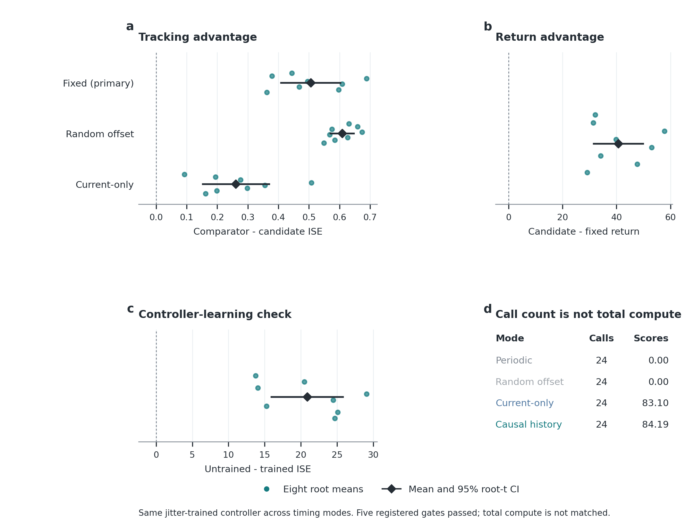
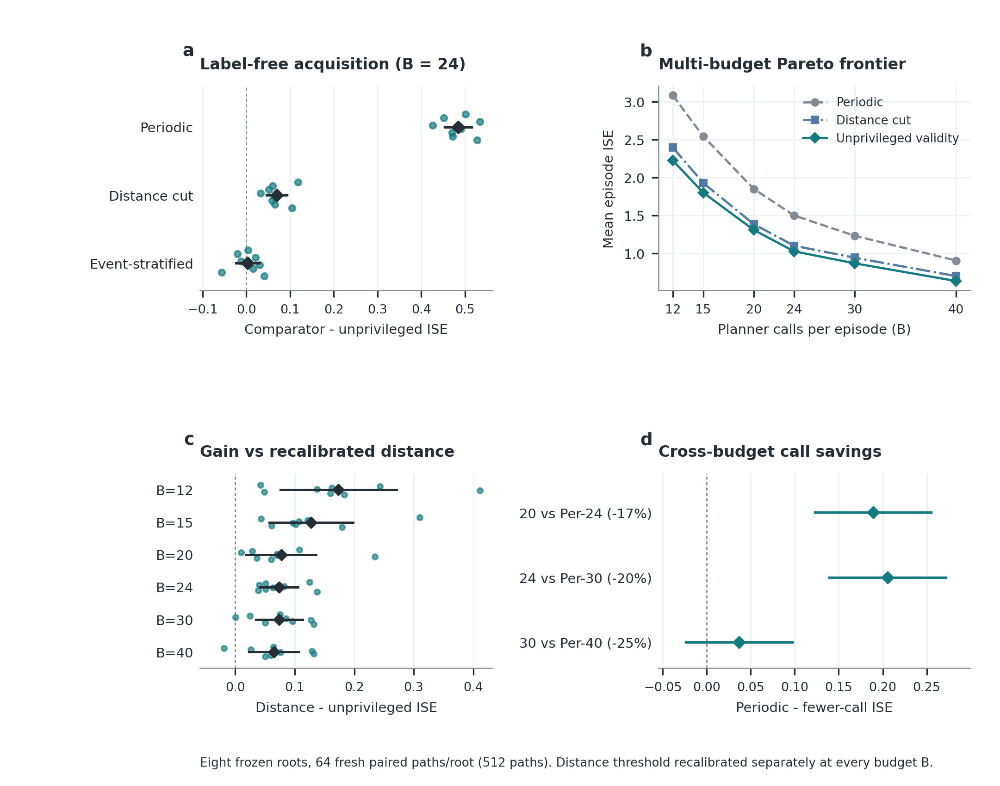
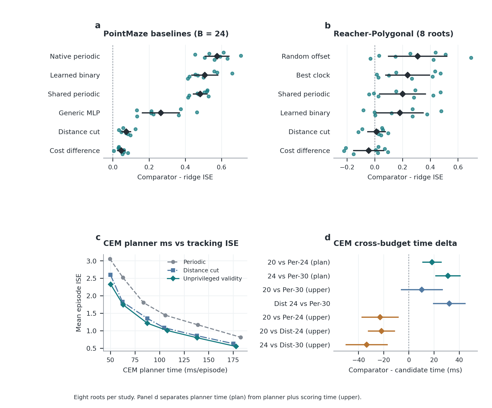

# Plan-Validity-Driven Replanning Under a Fixed Planning Budget

Working manuscript, 2026-11-18. Evidence and source map: [evidence_map.md](evidence_map.md).

## Abstract

A hierarchical controller must decide not only what plan to execute but also when to replace it. We study whether predicting the counterfactual value of renewing an active plan improves replanning timing under a fixed planner-call budget. A goal-conditioned upper and lower policy pair is trained under variable option durations, while paired simulator rollouts measure the short-horizon tracking loss difference between keeping and renewing the active waypoint under continuous closed-loop lower execution. At deployment, a causal predictor triggers the first threshold crossing within each planning bin, with a mandatory mid-bin deadline that guarantees an exact call count. Across eight independent PointMaze optimizer roots, the trigger reduced episode integrated squared tracking error (ISE) by 0.506 (95% CI 0.408--0.603; 34.94%) and increased return by 40.66 (95% CI 31.55--49.78) over periodic planning at 24 calls per episode. Eliminating privileged event metadata during offline query acquisition preserved the full gain on 512 fresh paired paths: uniform clock-grid supervision achieved mean ISE 1.01228 versus 1.49665 for periodic planning (32.36% lower) and 1.01512 for event-stratified supervision. On 512 additional paired paths against external adaptive-timing baselines, label-free relational plan-validity timing (ISE 0.99422) outperformed independently trained native-periodic HRL (36.65%), a TEMPLE state-change novelty gate (33.80%), a selected distance threshold (6.91%), a budgeted deliberation Option-Critic value gate (4.38%), and an unstructured 25-channel MLP predictor (21.05%) on all eight roots. Across six budgets from 12 to 40 calls, it dominated recalibrated distance thresholds at every budget and cut planner calls by 16.7%--20.0% at lower error; under a sampling-based cross-entropy method (CEM) subgoal planner, 20-call and 24-call adaptive schedules beat 24-call and 30-call periodic planning by 15.82% and 13.99% ISE while cutting CEM planner wall-clock time by 18.38 ms and 31.08 ms per episode. Finally, an eight-seed confirmation on nonlinear Reacher-v5 polygonal tracking alongside smooth-ellipse Reacher, LQR cart-pole, and transit timetable studies establishes when plan-validity timing transfers and where structural boundaries arise.

## 1. Introduction

Planning and execution in hierarchical control naturally operate on distinct time scales [@sutton1999between; @vezhnevets2017feudal; @nachum2018data]. A fast lower-level controller can continuously reject local disturbances using primitive sensory feedback while a higher-level waypoint or setpoint remains fixed. Periodic replanning makes this division simple to implement, yet allocates identical refresh intervals to plans that remain accurate and plans rendered obsolete by regime shifts or geometric corners. Inspired by metareasoning principles for the value of computation [@russell1991metareasoning] and event-triggered control [@astrom2002comparison; @tabuada2007event; @heemels2012introduction], we study an operational timing question: conditional on the closed-loop lower controller that executes each plan, when is the current plan worth replacing under a strict planner-call budget?

Temporal abstraction in reinforcement learning (RL) already provides mechanisms for variable option lengths, learned termination, and adaptive action repetition [@bacon2017option; @harb2018deliberation; @sharma2017figar; @zhou2020temple; @yu2021taac; @biedenkapp2021temporl]. End-to-end termination learning, however, couples controller representation drift with noisy single-trajectory credit assignment, often collapsing toward trivial every-step switching or deadline-only persistence unless deliberation penalties are delicately tuned [@harb2018deliberation]. Conversely, heuristic state-novelty gates [@zhou2020temple] or scalar subgoal-distance triggers react to rapid motion even along a still-valid trajectory or wait until tracking error has already accumulated. Separating renewal-timing supervision from policy optimization allows schedules to be evaluated under controlled upper and lower weights [@park2021sar] while directly targeting the causal effect of refreshing the plan.

We introduce a budgeted plan-validity replanning procedure built on top of standard goal-conditioned RL backends [@schulman2017ppo; @haarnoja2018sac; @fujimoto2018td3] and compatible with sampling-based upper planners [@deboer2005cem; @williams2017mppi]. Given a variable-duration goal-conditioned controller, paired simulator branches replay the same causal prefix twice---once retaining the current waypoint (`keep`) and once invoking the upper planner (`renew`)---while the lower controller acts closed-loop at every primitive step. A lightweight causal predictor is fitted to this short-horizon loss reduction and deployed inside fixed-length planning bins: within each bin, it triggers at the first check score exceeding a held-out quantile threshold \(q\) or at a mid-bin deadline, guaranteeing exactly one upper call per bin.

This paper makes five contributions:

1. **Exact-budget branch-supervised replanning.** We formulate constrained within-bin renewal timing supervised by paired counterfactual `keep`/`renew` rollouts, guaranteeing exact planner-call parity without invoking the upper planner during non-triggered checks, together with an explicit wall-clock compute break-even condition.
2. **Independent confirmation and label-free query ablation.** Across eight fresh PointMaze optimizer seeds, budgeted renewal timing passes all five preregistered confirmation gates and beats a timing portfolio under shared compute caps. A 512-path ablation proves that **label-free uniform clock-grid query acquisition** matches privileged event-stratified supervision (`1.01228` versus `1.01512` ISE) and beats tracking-distance thresholds on all eight roots.
3. **Comparison against external adaptive-timing baselines and unstructured neural predictors.** Across 512 paired PointMaze paths, structured relational plan-validity timing beats independently trained native-periodic HRL (`36.65%`), TEMPLE state-change gating (`33.80%`), distance thresholds (`6.91%`), and budgeted deliberation Option-Critic (`4.38%`) on all eight roots, while isolating the small-sample inductive-bias advantage (`21.05%`) of bilinear geometric interactions over a raw 25-channel MLP at 320 queries.
4. **Multi-budget Pareto frontier and CEM planner wall-clock validation.** Evaluating six call budgets \(B \in \{12, 15, 20, 24, 30, 40\}\) shows uniform dominance over periodic and per-budget recalibrated distance baselines (16.7%--20.0% call savings), and empirically decomposes planner execution savings (`18.38`--`31.08 ms/episode`) versus Python feature-check overhead under an iterative CEM subgoal optimizer.
5. **Second physical plant confirmation and structural applicability boundaries.** An independent eight-seed confirmation on 2-DOF nonlinear `Reacher-v5` polygonal trajectory tracking confirms positive timing gains over periodic, random-offset, best-clock, and TEMPLE schedules, while pairing with smooth-ellipse Reacher, LQR cart-pole, and an appendix transit boundary study to delineate when relational history outperforms reactive distance/value triggers and when episode-level verification is required.

## 2. Related Work

**Hierarchical RL and temporal abstraction.** Semi-Markov options [@sutton1999between] and goal-conditioned hierarchies such as FeUdal Networks [@vezhnevets2017feudal], HIRO [@nachum2018data], HAC [@levy2019hindsight], and causal-effect HRL [@corcoll2022disentangling] typically refresh subgoals on a fixed schedule of \(K\) primitive steps. Option-Critic [@bacon2017option] and deliberation-cost options [@harb2018deliberation] learn intra-option termination from value advantages \(V_U(s) - Q_U(s, g)\), which can suffer from value-estimation bias or variable episode call counts unless explicitly budgeted. Our controller uses semi-Markov upper updates and option-bounded lower generalized advantage estimation, while supervising renewal timing directly from paired counterfactual tracking rollouts.

**Adaptive decision frequency and action repetition.** Fine-grained action repetition (FiGAR) [@sharma2017figar], discretization-robust Q-learning [@tallec2019time], Safe Action Repetition [@park2021sar], TempoRL [@biedenkapp2021temporl], and TAAC [@yu2021taac] decide how long to hold a primitive physical action. Holding actuator commands open-loop degrades disturbance rejection when fast perturbations act within an option, motivating smooth closed-loop regularizers such as CAPS [@mysore2021caps], policy inertia [@chen2021inertia], and LipsNet [@song2023lipsnet; @song2025lipsnetpp]. Closer to our two-level setting, TEMPLE [@zhou2020temple] introduces a temporal gate driven by state change relative to the option-initiation state. Unlike open-loop action repetition or generic state-change novelty, our lower controller executes closed-loop feedback at every \(10\,\mathrm{ms}\) step while the upper call is scheduled by predicted plan invalidity within an exact per-bin budget.

**Event-triggered control and metareasoning.** Event-triggered and Lebesgue sampling controllers recompute control or model predictive control (MPC) solutions when error or Lyapunov triggers cross a threshold [@astrom2002comparison; @tabuada2007event; @heemels2012introduction; @li2014eventmpc], complementing sampling-based planners such as CEM and MPPI [@deboer2005cem; @williams2017mppi]. Rather than triggering solely on instantaneous subgoal proximity, our predictor estimates the counterfactual value of replanning [@russell1991metareasoning] from causal motion history [@zintgraf2020varibad; @konidaris2011fourier; @wang2026wavelet], paralleling dynamic test-time compute allocation in sequential agents [@paglieri2025learning; @achiam2017cpo].

## 3. Method

### 3.1 Hierarchical control and within-bin timing problem

Let \(h_t\) denote the causal observable history at primitive step \(t \in \{0, \dots, T - 1\}\) with sampling interval \(\Delta t\), and let \(g_t \in \mathbb{R}^d\) denote the active task-space waypoint. An upper planner \(\pi_U(u_t \mid s_t^U)\) outputs a bounded relative subgoal decoded around the current achieved position \(p_t\), while a goal-conditioned lower policy \(\pi_L(a_t \mid s_t^L, g_t)\) outputs physical actuator commands at every primitive step [@todorov2012mujoco]. Both levels are trained with PPO [@schulman2017ppo]: upper transitions accumulate discounted task reward over the realized inter-call duration \(\tau_k\) with bootstrap factor \(\gamma^{\tau_k}\), and lower intrinsic generalized advantage estimation terminates cleanly at realized waypoint boundaries.

For an episode of length \(T = 1200\) steps and nominal bin length \(K\) dividing \(T\), bin \(b \in \{0, \dots, B - 1\}\) spans primitive steps \(bK\) through \((b + 1)K - 1\), giving an exact episode budget of \(B = T / K\) planner calls. The initial call occurs at \(t = 0\). In each subsequent bin \(b \ge 1\), candidate renewal checks occur on a discrete grid of offsets \(\mathcal{O}_K = \{0, S, 2S, \dots, M\}\) with check stride \(S\) and deadline \(M = K / 2\) (for the nominal \(B = 24\) contract, \(K = 50\), \(M = 25\), and \(S = 5\), yielding check offsets \(\{0, 5, 10, 15, 20, 25\}\)). Once a call is made in bin \(b\), further checks in that bin are disabled and the refreshed waypoint is held until the next bin's call, bounding inter-call durations within \([K - M, K + M]\).

### 3.2 Variable-duration versus native-periodic controller training

Evaluating adaptive schedules on a controller trained exclusively at constant \(K\)-step intervals could confound schedule utility with out-of-distribution option lengths, whereas comparing only on variable-duration weights could leave open whether a specialist periodic controller performs better. Each independent optimizer root therefore trains our shared \(\pi_U\) and \(\pi_L\) for 384 PPO iterations using a seeded random-offset schedule (`balanced_jitter`, placing one call per 50-step bin at uniform offsets in \(\{0, \dots, 25\}\)), and in our external-baseline benchmarks we additionally train an independent **native-periodic HRL** controller (`offset = 0` throughout all 384 PPO iterations) under the identical architecture, seed budget, and lexicographic checkpoint-selection rule (negative episode ISE then episode return on disjoint selection paths).

### 3.3 Counterfactual branch supervision and label-free query acquisition

On disjoint branch-fit path seeds per root, a candidate query step \(t_q \notin \mathcal{S}_{\mathrm{prefix}}\) is replayed twice from the identical simulator and history prefix: the `keep` branch retains \(g_{t_q - 1}\), whereas the `renew` branch invokes \(\pi_U\) once at \(t_q\) to issue \(g_{t_q}^{\mathrm{new}}\). Both branches run the closed-loop lower controller \(\pi_L\) for the next \(H = 50\) steps without further upper calls, defining the counterfactual renewal advantage

\[
\Delta_H(h_{t_q}, g_{t_q - 1})
= L_H^{\mathrm{keep}}(h_{t_q}, g_{t_q - 1}) - L_H^{\mathrm{renew}}(h_{t_q}, g_{t_q - 1}),
\qquad
L_H = \Delta t \sum_{j=0}^{H-1} \|e_{t_q + j}\|_2^2,
\]

where \(e_{t_q + j} = y_{t_q + j} - p_{t_q + j}\) is the instantaneous tracking error. Positive \(\Delta_H\) indicates that renewing immediately reduces 50-step tracking ISE relative to keeping the stale waypoint. Exact prefix and causal-feature equality assertions guard every paired query.

We compare three offline query-acquisition protocols at matched query budgets:

1. **Event-stratified acquisition (original confirmation).** Queries are drawn equally across six simulator-defined opportunity classes (three lags after hidden target-regime switches, transient force pulses, reward-irrelevant distractor switches, and calm neutral windows). Event timestamps stratify offline training queries only and never enter features or deployment.
2. **Label-free uniform clock-grid acquisition (*unprivileged-uniform*).** Eligible non-colliding deployment check steps (\(b \in \{1, \dots, 22\}\), offsets \(\{0, 5, 10, 15, 20, 25\}\)) are partitioned into equal temporal strata per fit path, and one query step is sampled deterministically per stratum without inspecting simulator events or state trajectories.
3. **Label-free observable-change acquisition (*unprivileged-observable*).** A single causal rollout records observable target-velocity changes and force norms on the check grid, stratifying high-motion-change, high-force, and calm steps using observable history alone.

### 3.4 Causal predictor fitting and budgeted deployment

The structured renewal-value predictor constructs causal features from normalized plan age \((t - t_{\mathrm{last}}) / 50\), tracking and waypoint error vectors, multi-lag causal target-velocity estimates, measured force norms, and their relational bilinear dot-products (capturing directional alignment between waypoint error, target velocity, and velocity change); no hidden regime label, distractor channel, or future observation is included. Features are standardized on fit data and fitted via ridge regression with an unpenalized intercept, selecting \(\alpha \in \{10^{-2}, 10^{-1}, \dots, 10^{4}\}\) by leave-one-fit-path-out cross-validation MSE.

In the fixed-budget confirmation (\(B = 24\)), the deployment threshold \(q\) is set to the 75th percentile of leave-one-fit-path-out predictions \(\hat{\Delta}_{\mathrm{oof}}\) using fit paths only. When calibrating across general call budgets \(B = T / K\) or external baselines, scalar quantile or threshold parameters are selected on disjoint timing-selection paths per root while holding controller and predictor weights fixed.

```text
Fit and select the variable-duration controller on disjoint training and selection paths.
Acquire paired keep/renew labels on disjoint branch-fit paths (event-stratified or label-free).
Fit causal predictor weights and threshold q without accessing evaluation paths.
For each held-out episode (horizon T, bin length K, deadline M = K/2, stride S):
    Call pi_U at step t = 0.
    In each subsequent bin b = 1, ..., T/K - 1:
        At check offsets 0, S, 2S, ..., M, until one call occurs in bin b:
            Score causal plan and history features (without calling pi_U).
            Invoke pi_U if score >= q or offset == M.
    Execute closed-loop lower policy pi_L at every primitive step t.
```

### 3.5 Predictor inductive bias, adaptive baselines, and compute break-even

To test whether relational geometric dot-products act as domain-specific feature engineering or as a small-sample inductive bias, we train an unstructured two-layer neural network (**generic MLP**, \(25 \to 64 \to 64 \to 1\) with LayerNorm, SiLU activations, cosine-annealed AdamW, and path-grouped early stopping) on the 25 raw causal channels (plan age, positions, velocities, active subgoal, causal target velocities, innovations, and actuator forces) with zero hand-crafted products or norms, supervised by the identical label-free uniform branch targets. We also adapt two representative HRL timing gates to the exact within-bin budget contract: (i) a **TEMPLE state-change novelty gate** [@zhou2020temple] scoring normalized state displacement \(\|(s_t - s_{t_{\mathrm{last}}}) \oslash \sigma_s\|_2\) since the last upper call, and (ii) a **budgeted deliberation Option-Critic gate** [@harb2018deliberation] scoring the upper critic's termination advantage \(V_U(s_t^U) - \hat{Q}_{\mathrm{keep}}(s_t^U, g_{t-1})\) regularized by held-out selection calibration.

Finally, let \(c_{\mathrm{plan}}\) denote the wall-clock cost of one upper planner call and \(c_{\mathrm{check}}\) the cost of one causal feature extraction and trigger check. Replacing a \(B\)-call periodic schedule (zero checks) with an adaptive \((B - \Delta B)\)-call schedule that executes \(N_{\mathrm{check}}(B - \Delta B)\) checks reduces net upper-loop wall-clock time whenever

\[
\Delta B \cdot c_{\mathrm{plan}} > N_{\mathrm{check}}(B - \Delta B) \cdot c_{\mathrm{check}}
\iff
\frac{c_{\mathrm{plan}}}{c_{\mathrm{check}}} > \frac{N_{\mathrm{check}}(B - \Delta B)}{\Delta B}.
\]

To measure both terms empirically beyond a single-forward-pass MLP actor, we wrap \(\pi_U\) in a two-iteration **Cross-Entropy Method (CEM)** subgoal optimizer [@deboer2005cem] evaluating \(64 \times 2 = 128\) candidate subgoals per planner call via batched upper value-network rollouts.


**Figure 1 | Supervision and budgeted deployment.** (a) Offline paired `keep`/`renew` simulator branches (using either event-stratified or label-free clock-grid queries) supervise a 39-feature causal predictor. Online deployment checks every five steps up to the mid-bin deadline, invoking \(\pi_U\) at the first threshold crossing or the deadline. (b) Observed upper-call times over the first 300 steps of the first registered confirmation root and path (`209011` / `2180301`), chosen prospectively rather than for performance. Alternating bands mark 50-step bins; dotted lines mark offset-25 deadlines; \(\pi_L\) acts closed-loop at every step.

## 4. Experimental Design

### 4.1 PointMaze confirmation, portfolio caps, and external adaptive baselines

The PointMaze hidden-regime task drives a continuous target along a U-shaped corridor (\(\Delta t = 0.01\,\mathrm{s}\), \(T = 1200\)) under piecewise-constant hidden speed switches (`-1.25, -0.55, +0.55, +1.25` route-units/s with `0.80--1.60 s` dwells), transient actuator force pulses (`0.04--0.10 s`), and independent distractor shifts. Independent confirmation ran on eight fresh optimizer seeds (`209011`--`209101`), each with disjoint path banks (8 training, 8 checkpoint-selection, 8 branch-fit, and 16 evaluation paths). Four modes share each root's controller on the same evaluation paths: periodic (`offset = 0`), random-offset (`balanced_jitter`), a 170-feature current-only quadratic trigger, and the 39-feature causal-history candidate. Path differences are averaged within each root first; inference uses two-sided 95% Student-\(t\) intervals across the eight paired root means (\(\mathrm{df} = 7\)) [@holm1979multiple; @wilson1927interval]. All five registered lower bounds (ISE gains over periodic, random-offset, and current-only; return gain over periodic; and trained-over-untrained controller learning) must be strictly positive.

On a second eight-root PointMaze cohort (`1981400000`--`1981470000`) governed by lifecycle compute caps (`10,000` CPU-s at 100 deployments, `6.5M` offline steps, `10 ms` p99 step latency), frozen follow-ups first compared the candidate against per-root selected tracking-distance thresholds (256 paired paths) and a selection-based portfolio of learned option termination and best constant clocks (512 paired paths; the all-learned gate remained held without test release because one root trailed its clock by `0.01718` selection ISE). Next, on 512 fresh disjoint paths (`1982300000`+; 64 paths/root), we benchmarked label-free relational ridge (`ridge_unprivileged`, 25 compact relational features) and the raw 25-channel neural predictor (`generic_mlp_unprivileged`, both trained on 320 uniform clock-grid branch queries across 16 fit paths/root) against independently trained **native-periodic HRL**, shared periodic/jitter schedules, **TEMPLE** novelty gating, **deliberation Option-Critic** value gating, and selected tracking-distance thresholds.

### 4.2 Label-free query ablation, multi-budget Pareto, and CEM wall-clock protocol

Using the eight frozen builds (`1981400000`--`1981470000`) and their exact eight branch-fit seeds (192 paired queries/root), we fitted *unprivileged-uniform* and *unprivileged-observable* predictors without hidden event clocks and evaluated them on 512 fresh paired paths (`1982100000`+). Across six exact planning budgets \(B \in \{12, 15, 20, 24, 30, 40\}\) (\(K \in \{100, 80, 60, 50, 40, 30\}\), \(M = K / 2\), \(S = M / 5\)), we calibrated constant clocks, tracking-distance thresholds, and predictor quantiles separately at each \(B\) on disjoint selection paths and evaluated all frozen rules on 512 fresh paired paths per budget (`1982200000`+; 15,360 episodes). We then wrapped each root's upper planner in the 128-candidate CEM optimizer and measured per-episode planner time, trigger feature-check time, total control time, and ISE across all six budgets on 256 fresh paired paths per budget (`1982400000`+).

### 4.3 Second physical plant confirmation and applicability screens

To test end-to-end generalization on a distinct nonlinear robotic plant with genuine geometric plan invalidation, we constructed a **polygonal trajectory tracking task** on MuJoCo's 2-DOF torque-controlled `Reacher-v5` arm (\(\Delta t = 0.02\,\mathrm{s}\), \(T = 1200\)). Unlike smooth elliptical motion, the target traverses a five-vertex inscribed pentagon along straight chords with sharp \(72^\circ\) corners and hidden speed-mode switches (`0.55x`, `1.00x`, `1.45x` nominal speed). Across eight fresh independent optimizer roots (`1983100000`--`1983170000`), we trained both variable-duration shared controllers and independent native-periodic HRL controllers (384 PPO iterations each), acquired 320 label-free uniform branch queries per root, calibrated all timing gates on disjoint selection paths, and evaluated all nine methods on 64 fresh held-out paths per root (512 paired paths; zero roots excluded).

Finally, to isolate why adaptive timing succeeds on polygonal Reacher and PointMaze but stalls elsewhere, we pair this confirmation with diagnostic applicability screens on smooth elliptical `Reacher-v5` tracking (24 paired paths/root) and LQR-stabilized `InvertedPendulum-v5` cart-position tracking at LQR weights 10 and 30 (24 paired paths/configuration plus a 32-path crossed factorial), testing (i) **waypoint freshness** (current versus one-bin-lagged waypoint at a fixed clock) and (ii) **timing opportunity** (transition-aligned calls versus best fixed clock and bin-rotated schedules). Appendix A reports a separate repeated-decision episode boundary in transit timetable control. All seed banks across all protocols were verified pairwise disjoint prior to evaluation.

## 5. Results

### 5.1 Independent PointMaze confirmation and portfolio benchmarks

All five preregistered confirmation gates passed on the eight independent optimizer roots (Table 1; Figure 2). Every individual root showed positive ISE and return gains over periodic planning. Pooled mean episode ISE was `1.447072` under periodic timing, `1.549716` under random offsets, `1.202303` under the 170-feature current-only trigger, and `0.941530` under the 39-feature causal-history trigger (a 34.94% reduction relative to periodic timing). Every mode executed exactly 24 planner calls per episode; the causal-history trigger placed `13.1953` pre-deadline calls on average and evaluated `84.1875` linear score checks per episode (range 48--120). The preceding eight-root development cohort independently passed the same gates (ISE gain `0.396372`, 95% CI `[0.275784, 0.516959]`; return gain `30.770657`, 95% CI `[21.111415, 40.429899]`).

**Table 1. Frozen independent-seed PointMaze confirmation.** Positive contrasts favor the causal-history candidate or the trained controller. Intervals are two-sided 95% Student-\(t\) bounds across eight paired optimizer-root means (\(\mathrm{df} = 7\)).

| Registered contrast | Mean | 95% CI |
| --- | ---: | --- |
| Fixed - candidate episode ISE | 0.505541 | [0.408443, 0.602640] |
| Random-offset - candidate episode ISE | 0.608186 | [0.570111, 0.646260] |
| Current-only - candidate episode ISE | 0.260773 | [0.152216, 0.369331] |
| Candidate - fixed episode return | 40.662456 | [31.548406, 49.776506] |
| Untrained - trained controller ISE | 20.862987 | [15.939428, 25.786547] |



**Figure 2 | Independent-seed PointMaze confirmation.** (a) Paired root ISE advantages over periodic (primary), random-offset, and current-only timing; (b) episode return advantage over periodic timing; (c) controller-learning verification comparing untrained and trained controller ISE; (d) mean planner calls and trigger score checks per episode. Teal dots denote the eight optimizer-root means (16 evaluation paths each); black diamonds and bars denote grand means and 95% Student-\(t\) intervals (\(\mathrm{df} = 7\)).

On the lifecycle-capped cohort, the frozen rule reduced mean ISE by 7.28% relative to per-root selected tracking-distance thresholds on 256 diagnostic paths (`1.01091` versus `1.09029`, gain `0.07938`, 95% CI `[0.03008, 0.12868]`, 8/8 roots), and outperformed both the distance threshold by 5.81% (7/8 roots) and the learned-termination/best-clock portfolio by 21.56% (8/8 roots) on 512 subsequent paired paths under shared CPU, step, and `10 ms` p99 latency caps (realized max p99 `1.78 ms`; Table 2). A capacity-matched 91-parameter quadratic ablation on 512 paths further showed that \(100\,\mathrm{ms}\) target-velocity and force-RMS history reduced ISE by 6.44% over instantaneous features (`1.14792` versus `1.22699`, 95% CI `[0.01870, 0.13942]`, 8/8 roots), whereas a \(500\,\mathrm{ms}\) velocity window degraded ISE by 5.85% (`1.21502`).

**Table 2. PointMaze timing portfolio and distance threshold.** Positive gains favor the plan-validity timing rule (mean ISE: 0.99934) across 512 paired fresh paths on eight frozen controller builds.

| Comparator | Episode ISE (Stage9: 0.99934) | Paired root ISE gain [nominal 95% CI] | Relative gain |
| --- | ---: | --- | ---: |
| Selected distance threshold | 1.06097 | 0.06163 [0.01980, 0.10345] | 5.81% |
| Selected termination or clock | 1.27402 | 0.27467 [0.19309, 0.35625] | 21.56% |

### 5.2 Label-free query acquisition matches event-stratified supervision

Eliminating privileged simulator event metadata from offline branch acquisition caused zero performance loss across 512 fresh paired paths (Table 3; Figure 3a). Uniform clock-grid query acquisition (*unprivileged-uniform*, mean ISE `1.01228`) improved ISE by 32.36% over periodic planning (8/8 roots), by 36.59% over random offsets (8/8 roots), and by 6.42% over the selected tracking-distance threshold (8/8 roots, first/last path halves `+5.58%` and `+7.24%`). Its contrast with event-stratified supervision (`1.01512`) was centered at zero (`0.00284`, 95% CI `[-0.02368, 0.02936]`). Observable-change stratification (*unprivileged-observable*, `1.03618`) similarly beat periodic planning (`30.77%`) and the distance threshold (`4.21%`, 95% CI `[0.02998, 0.06121]`, 8/8 roots).

**Table 3. Label-free renewal-query acquisition at \(B = 24\) calls.** Positive contrasts favor the unprivileged predictor (*unprivileged-uniform* mean ISE: `1.01228`, return: `944.15`) across eight frozen roots (512 paired paths).

| Contrast (`Comparator - candidate` ISE) | Paired ISE gain | 95% CI | Relative gain | Favorable roots |
| --- | ---: | --- | ---: | ---: |
| Periodic - unprivileged uniform | 0.48437 | [0.45359, 0.51516] | 32.36% | 8/8 |
| Random-offset - unprivileged uniform | 0.58411 | [0.54480, 0.62343] | 36.59% | 8/8 |
| Distance threshold - unprivileged uniform | 0.06950 | [0.04608, 0.09292] | 6.42% | 8/8 |
| Event-stratified - unprivileged uniform | 0.00284 | [-0.02368, 0.02936] | 0.28% | 5/8 |
| Distance threshold - unprivileged observable | 0.04560 | [0.02998, 0.06121] | 4.21% | 8/8 |

### 5.3 External adaptive-timing baselines, native-periodic HRL, and predictor inductive bias

Table 4 and Figure 4a resolve three potential confounds on 512 fresh paired PointMaze paths. First, training an independent **native-periodic HRL** controller exclusively at `offset = 0` yielded slightly higher periodic error (`1.56950`) than evaluating periodic timing on the variable-duration controller (`1.47639`), confirming that variable-duration training acts as beneficial regularization rather than handicapping periodic planning; label-free relational ridge (`0.99422` ISE, return `945.89`) beat native-periodic HRL by 36.65% (`0.57529`, 95% CI `[0.50935, 0.64123]`, 8/8 roots; return gain `+48.10`). Second, against external HRL gates under the identical within-bin budget, relational plan-validity beat **TEMPLE** state-change novelty gating (`1.50176`) by 33.80% (8/8 roots)---because generic state displacement fires rapidly along fast straight segments where the active plan remains valid---and beat **budgeted deliberation Option-Critic** (`1.03971`) by 4.38% (`0.04550`, 95% CI `[0.02553, 0.06546]`, 8/8 roots, first/last path halves `+4.29%` and `+4.46%`). Third, the unstructured 25-channel **generic MLP** (`1.25927`) still significantly outperformed native-periodic HRL (`19.77%`, 95% CI `[0.24400, 0.37647]`, 8/8 roots), shared periodic (`14.71%`, 8/8 roots), and TEMPLE (`16.15%`, 7/8 roots), demonstrating that counterfactual branch supervision carries signal without hand-crafted features; however, at a frugal 320-query budget (16 fit paths), relational bilinear features reduced ISE by a further 21.05% (`0.26505`, 8/8 roots) by preventing overfitting to absolute corridor coordinates.

**Table 4. PointMaze external baselines, native-periodic HRL, and predictor inductive bias (\(B = 24\), 512 paired paths).** Positive gains favor label-free relational plan-validity ridge (mean ISE: `0.99422`, return: `945.89`) across eight roots.

| Comparator | Comparator ISE | Paired ISE gain [95% CI] | Relative gain | Roots |
| --- | ---: | --- | ---: | ---: |
| Native-periodic HRL | 1.56950 | 0.57529 [0.50935, 0.64123] | 36.65% | 8/8 |
| Shared periodic | 1.47639 | 0.48217 [0.44477, 0.51958] | 32.66% | 8/8 |
| TEMPLE novelty gate | 1.50176 | 0.50754 [0.43627, 0.57881] | 33.80% | 8/8 |
| Distance threshold | 1.06802 | 0.07380 [0.04960, 0.09801] | 6.91% | 8/8 |
| Deliberation Option-Critic | 1.03971 | 0.04550 [0.02553, 0.06546] | 4.38% | 8/8 |
| Generic MLP (raw 25-ch) | 1.25927 | 0.26505 [0.16322, 0.36689] | 21.05% | 8/8 |

### 5.4 Multi-budget Pareto frontier and CEM planner wall-clock validation

Across all six planner-call budgets \(B \in \{12, 15, 20, 24, 30, 40\}\), label-free plan-validity timing achieved strictly lower episode ISE than periodic, best-clock, and per-budget recalibrated distance thresholds, with positive two-sided 95% intervals at every budget (Table 5; Figure 3b,c). Relative ISE reductions ranged from 27.85% to 31.47% over periodic planning (8/8 roots at every budget) and from 5.56% to 9.25% over recalibrated distance cuts. Cross-budget comparisons confirm substantial call compression (Figure 3d): **20 adaptive calls** (`1.31047`) beat **24 periodic calls** (`1.49962`) by `0.18914` (95% CI `[0.12310, 0.25519]`; 12.61% lower ISE on 8/8 roots with 16.7% fewer calls), and **24 adaptive calls** (`1.02774`) beat **30 periodic calls** (`1.23319`) by `0.20545` (95% CI `[0.13924, 0.27166]`; 16.66% lower ISE on 8/8 roots with 20.0% fewer calls).

**Table 5. Multi-budget planning Pareto frontier across 512 fresh paired paths per budget.** Distance thresholds and predictor quantiles are calibrated on disjoint selection paths separately at each budget \(B\).

| Calls \(B\) (bin \(K\)) | Periodic ISE | Distance cut ISE | Unprivileged ISE | Gain vs. distance [95% CI] | Gain vs. periodic |
| --- | ---: | ---: | ---: | --- | ---: |
| 12 (\(K = 100\)) | 3.08421 | 2.39868 | 2.22519 | 0.17350 [0.07589, 0.27110] | 27.85% |
| 15 (\(K = 80\)) | 2.54477 | 1.93024 | 1.80257 | 0.12767 [0.05736, 0.19798] | 29.17% |
| 20 (\(K = 60\)) | 1.85168 | 1.38767 | 1.31047 | 0.07720 [0.01843, 0.13597] | 29.23% |
| 24 (\(K = 50\)) | 1.49962 | 1.10141 | 1.02774 | 0.07367 [0.04158, 0.10576] | 31.47% |
| 30 (\(K = 40\)) | 1.23319 | 0.94373 | 0.86969 | 0.07405 [0.03510, 0.11299] | 29.48% |
| 40 (\(K = 30\)) | 0.90651 | 0.70179 | 0.63689 | 0.06489 [0.02313, 0.10666] | 29.74% |



**Figure 3 | Label-free supervision and multi-budget planning Pareto frontier.** (a) At \(B = 24\), uniform clock-grid branch acquisition beats periodic and tracking-distance baselines across all eight roots and matches event-stratified supervision. (b) Episode ISE across budgets \(B \in \{12, 15, 20, 24, 30, 40\}\), showing uniform Pareto dominance of label-free plan-validity timing. (c) Per-budget paired root ISE advantages over recalibrated tracking-distance thresholds (all six 95% CIs strictly positive). (d) Cross-budget ISE advantages when using 17%--25% fewer planner calls than periodic planning.

Replacing the direct upper forward pass with the 128-candidate **CEM subgoal planner** preserved Pareto dominance across all six budgets (`23.83%`--`32.67%` lower ISE than periodic on 8/8 roots, and lower point-estimate ISE than distance thresholds at every budget with 95% CIs strictly positive at \(B \in \{12, 20, 30, 40\}\); Table 6; Figure 4c). Moreover, timing decomposition empirically validates our break-even equation (Figure 4d): one batched PyTorch CEM call cost \(c_{\mathrm{plan}} \approx 4.38\,\mathrm{ms}\), whereas unvectorized pure-Python history feature extraction cost \(c_{\mathrm{check}} \approx 0.71\,\mathrm{ms}\) (\(c_{\mathrm{plan}} / c_{\mathrm{check}} \approx 6.2\)). Consequently, **20-call adaptive CEM** (`1.21456` ISE) beat **24-call periodic CEM** (`1.44276`) by 15.82% ISE (`0.22821`, 95% CI `[0.17814, 0.27827]`, 8/8 roots) while cutting **CEM planner execution time** by `18.38 ms/episode` (`95% CI [11.12, 25.65]`, 8/8 roots), and **24-call adaptive CEM** beat **30-call periodic CEM** by 13.99% ISE (`0.16341`, 95% CI `[0.07660, 0.25022]`) while saving `31.08 ms/episode` of CEM planner time (`[21.49, 40.66]`, 8/8 roots). At \(\Delta B = 4\), \(58.31\) Python feature checks added `41.20 ms`, making net upper-loop time `+22.81 ms` slower (`-22.81 ms` saved) until \(\Delta B = 10\) (`20` versus `30` calls, net saving `+10.28 ms`) or until either \(c_{\mathrm{plan}} \gtrsim 10.4\,\mathrm{ms}\) (multi-step MPC/MPPI rollouts) or \(c_{\mathrm{check}}\) is compiled (`0.03 ms/check` for scalar distance, which saved `32.06 ms/episode` net at `24` versus `30` calls).

**Table 6. CEM subgoal planner accuracy and wall-clock decomposition (256 paired paths/budget).** Columns report episode ISE and per-episode wall-clock times (ms) for CEM planning (`Plan ms`) and Python trigger checks (`Check ms`).

| Calls \(B\) | Periodic ISE | Distance ISE | Unprivileged ISE | Gain vs. periodic [95% CI] | Plan ms | Check ms |
| --- | ---: | ---: | ---: | --- | ---: | ---: |
| 12 | 3.05587 | 2.59857 | 2.32774 | 0.72813 [0.60337, 0.85288] | 50.22 | 22.70 |
| 15 | 2.51956 | 1.82694 | 1.74231 | 0.77725 [0.66598, 0.88852] | 62.93 | 32.55 |
| 20 | 1.80377 | 1.35345 | 1.21456 | 0.58921 [0.50519, 0.67322] | 87.57 | 41.20 |
| 24 | 1.44276 | 1.08649 | 1.00496 | 0.43781 [0.35064, 0.52498] | 107.97 | 66.57 |
| 30 | 1.16837 | 0.85759 | 0.79823 | 0.37014 [0.32450, 0.41578] | 138.30 | 74.00 |
| 40 | 0.81310 | 0.63007 | 0.54905 | 0.26405 [0.22296, 0.30514] | 178.02 | 105.35 |



**Figure 4 | External adaptive baselines, second-plant confirmation, and CEM compute trade-off.** (a) Paired eight-root PointMaze ISE gains (`Comparator - ridge_unprivileged`) at \(B = 24\), beating native-periodic HRL, TEMPLE, distance cut, deliberation Option-Critic, and the unstructured MLP on all eight roots. (b) Independent eight-root confirmation on nonlinear `Reacher-v5` polygonal tracking (unfiltered across all eight roots). (c) Real measured CEM planner wall-clock time versus episode ISE across \(B \in \{12, \dots, 40\}\). (d) Cross-budget CEM planner savings (`plan`, teal) versus net upper-loop time including pure-Python feature checks (`net`, blue/orange).

### 5.5 Second physical plant confirmation and structural applicability boundaries

Across all eight fresh unfiltered optimizer roots on nonlinear 2-DOF `Reacher-v5` polygonal tracking (512 paired paths; controller-learning ISE gain `5.44183`, 95% CI `[4.73186, 6.15179]`; mean waypoint authority `+18.24%`), label-free relational plan-validity (`4.48852` ISE, return `703.08`) significantly outperformed random-offset timing (`+6.44%`), the per-root **best fixed clock** (`+5.00%`, 8/8 roots), **shared periodic** timing (`+4.27%`), and **TEMPLE** state-change gating (`+3.86%`), with positive two-sided 95% return and ISE intervals on all four comparisons (Table 7; Figure 4b). Notably, the unstructured **generic MLP** (`4.57433`) also beat best fixed clock (`0.15054`, 95% CI `[0.06006, 0.24101]`, 7/8 roots), shared periodic (`0.11419`, `[0.00610, 0.22228]`), and TEMPLE (`0.09452`, `[0.00184, 0.18721]`) without domain-specific dot-products.

**Table 7. Independent eight-seed confirmation on 2-DOF `Reacher-v5` polygonal tracking (\(B = 24\), 512 paired paths).** Positive contrasts favor label-free relational plan-validity ridge (mean ISE: `4.48852`, return: `703.08`) across all eight unfiltered roots.

| Comparator | Comparator ISE | Paired ISE gain [95% CI] | Relative gain | Roots |
| --- | ---: | --- | ---: | ---: |
| Random-offset | 4.79737 | 0.30885 [0.09895, 0.51874] | +6.44% | 7/8 |
| Best fixed clock | 4.72486 | 0.23634 [0.07881, 0.39387] | +5.00% | 8/8 |
| Shared periodic | 4.68852 | 0.20000 [0.03472, 0.36528] | +4.27% | 6/8 |
| TEMPLE novelty gate | 4.66885 | 0.18033 [0.01249, 0.34817] | +3.86% | 6/8 |
| Distance threshold | 4.50019 | 0.01166 [-0.05165, 0.07498] | +0.26% | 6/8 |
| Deliberation Option-Critic | 4.44330 | -0.04522 [-0.15268, 0.06224] | -1.02% | 5/8 |
| Native-periodic HRL | 4.55387 | 0.06534 [-1.09412, 1.22481] | +1.43% | 4/8 |

Simultaneously, `Reacher-v5` polygonal tracking illuminates two clean mechanistic boundaries. First, on the fully actuated manipulator without corridor walls, scalar subgoal distance (`4.50019`) and upper value-advantage gating (`4.44330`) matched relational plan-validity (`95%` CIs crossing zero), whereas in wall-constrained PointMaze with momentum overshoot and force pulses, relational history beat both on 8/8 roots (Table 4). Second, descriptive conditioning across the eight roots directly mirrors our applicability screens (Table 8): on the six roots where PPO acquired strong waypoint authority (`14.9%`--`30.7%`), relational timing lowered ISE from `4.4544` (shared periodic) and `4.7446` (native-periodic HRL) to `4.1908`, whereas on the two roots where shared PPO failed to acquire waypoint authority (`0.1%`--`0.2%`), all seven shared-controller timing rules tied within `5.38`--`5.41` (explaining the wide between-run interval against independently trained native-periodic HRL).

**Table 8. Structural applicability screens.** Positive entries denote relative reductions in whole-episode ISE versus the comparator on paired development paths.

| Frozen root or configuration | Current vs previous waypoint | Event vs selected clock | Event vs rotated offsets |
| --- | ---: | ---: | ---: |
| Reacher 1972210000 | +12.30% | -0.22% | +0.30% |
| Reacher 1972220000 | +6.02% | +1.99% | +1.41% |
| Cart-pole, LQR position weight 10 | -8.30% | +5.13% | +5.03% |
| Cart-pole, LQR position weight 30 | +4.41% | +10.03% | +9.77% |

Table 8 completes this structural picture: smooth elliptical `Reacher-v5` had positive waypoint freshness (`+12.30%`, `+6.02%`) but no sharp corner invalidation (`-0.22%` to `+1.99%`), whereas LQR cart-pole had clear timing opportunity (`+5.03%` to `+10.03%`) whose waypoint freshness flipped sign with lower-controller gain (`-8.30%` at weight 10 versus `+4.41%` at weight 30; confirmed on a 32-path crossed factorial, freshness shift `0.02458`, 95% CI `[0.02299, 0.02618]`).

## 6. Discussion and Limitations

**What counterfactual branch supervision buys---and when relational features matter.** Replaying `keep` and `renew` from an identical prefix removes exogenous trajectory noise from the renewal target \(\Delta_H\), allowing pure clock-grid query acquisition without hidden event labels (Section 5.2). Even an unstructured 25-channel MLP trained on 320 paired queries beats periodic, random-offset, best-clock, and TEMPLE novelty gates on both PointMaze and polygonal Reacher (Tables 4 and 7). Relational bilinear features provide an additional `21.05%` sample-efficiency gain on PointMaze by encoding translation-invariant alignment between plan error and velocity changes, outperforming reactive distance cuts and deliberation Option-Critic across walls and momentum disturbances while tying them on unobstructed manipulator chords.

**Limitations.** First, as quantified by our CEM wall-clock decomposition (Section 5.4), saving planner calls translates into net wall-clock savings only when the planner-to-check cost ratio exceeds \(N_{\mathrm{check}} / \Delta B\); compiling feature extraction out of Python or targeting multi-horizon trajectory planners (`>10.4 ms/call`) is needed for net speedup at small \(\Delta B\). Second, branch supervision requires an offline resettable simulator during the fit phase (`192`--`320` short rollouts per root), though online deployment is strictly causal and reset-free. Third, Appendix A shows that greedy short-horizon decision screening without episode-level risk constraints can fail when rare discrete resource jumps dominate cumulative episode cost.

## 7. Reproducibility

All experiment modules, polygonal manipulator dynamics, evaluation runners, and frozen protocols are listed in [artifact_files.txt](artifact_files.txt) across the `freq_hrl`, `scripts`, and `protocols` directories. Running `make reproduce` inside `paper/` rebuilds the compact evidence record from saved local summaries, renders all five vector and raster figures together with their CSV provenance tables, compiles the PDF manuscript, and executes automated unit tests verifying exact table and CSV numerical transcription, seed-bank disjointness, citation resolution, and canvas-bounded vector text completely offline.

## 8. Conclusion

Counterfactual plan-validity supervision enables exact-budget hierarchical replanning without privileged event labels. Across PointMaze hidden-regime tracking and nonlinear `Reacher-v5` polygonal tracking, label-free branch supervision consistently outperforms periodic, random-offset, best-clock, and state-change novelty schedules; dominates recalibrated distance and value-termination baselines when momentum and geometry make scalar proximity myopic; compresses planner calls by 16.7%--20.0% along the multi-budget Pareto frontier; and provides transparent compute and applicability criteria for hierarchical control.

## Appendix A. Repeated-Decision Boundary in Transit Timetable Control

To examine whether validated single-intervention value guarantees full-episode improvement under repeated discrete resource constraints, we report an auxiliary boundary study in a native bidirectional bus corridor simulator. Unlike within-bin waypoint timing, this domain uses finite-Monte-Carlo action selection (`P8` proposals screened on `S8` rollouts) to choose timetable headways above a frozen lower holding controller.

In two independent 400-prefix single-intervention cohorts (Cohorts A and B), both a service-only selector and a joint fleet-plus-service selector significantly reduced total cost and passenger waiting relative to raw control under both prefix-bootstrap and conditional-Monte-Carlo 95% intervals (Table 9; Figure 5a,b), though the learned fleet critic provided no extra cost reduction over service-only (`0.074 s` average single-intervention wait saving). However, in a subsequent 320-scene complete-episode evaluation intervening at two consecutive upper callbacks (callbacks 8 and 9 of 44; 219,520 native episodes), service-only total cost increased at the point estimate (`+1901.331 x 1e-6`), normal waiting intervals crossed zero, and the preregistered 50% base-wait retention criterion failed (Table 10; Figure 5c--f). Descriptive decomposition showed that four discrete peak-fleet jumps (three increases, one decrease) outweighed continuous service savings, illustrating why local short-horizon value must be paired with episode-level verification when rare discrete resource penalties are present. Additional historical PointMaze upper-policy learning checks (`+0.17%` to `+0.48%` return gains under staged fixed-lower updates) are archived in `evidence_map.md` and are not pooled with the timing confirmation.

**Table 9. Native Transit single-intervention outcomes.** Negative values favor the first controller; cost and waiting-minute contrasts are scaled by \(10^6\).

| Study / contrast / endpoint | Mean | Prefix CI95 | Conditional MC CI95 |
| --- | ---: | --- | --- |
| Stage298 / joint - raw / cost | -202.006 | [-288.844, -119.627] | [-265.551, -138.460] |
| Stage298 / joint - raw / wait | -1182.737 | [-1658.035, -781.291] | [-1299.168, -1066.305] |
| Stage301 / service-only - raw / cost | -318.120 | [-424.992, -215.424] | [-396.701, -239.539] |
| Stage301 / service-only - raw / wait | -1230.467 | [-1757.211, -825.834] | [-1357.549, -1103.385] |
| Stage301 / joint - raw / cost | -307.139 | [-403.590, -216.799] | [-376.580, -237.698] |
| Stage301 / joint - raw / wait | -1070.902 | [-1583.164, -673.425] | [-1185.750, -956.054] |
| Stage301 / joint - service-only / cost | 10.981 | [-38.466, 60.105] | [-26.841, 48.802] |
| Stage301 / joint - service-only / wait | 159.565 | [82.814, 250.561] | [110.377, 208.754] |

**Table 10. Complete-episode Transit boundary (two consecutive interventions across 320 scenes).** Negative values favor the first controller (\(10^6\) scaling).

| Contrast / endpoint | Mean | Episode bootstrap CI95 | Paired normal CI95 |
| --- | ---: | --- | --- |
| service-only - raw / cost | 1901.331 | [-2729.400, 6937.962] | [-2856.632, 6659.294] |
| service-only - raw / service component | -702.835 | [-1497.065, -120.823] | [-1414.375, 8.704] |
| service-only - raw / wait | -5706.250 | [-12519.141, -787.422] | [-11818.256, 405.756] |
| joint - service-only / cost | 28.572 | [-5.247, 84.056] | [-19.407, 76.551] |


**Figure 5 | Local Transit gains and the repeated-decision episode boundary.** (a,b) Single-intervention cost and waiting reductions on two 400-prefix cohorts (`Stage298` = Cohort A, `Stage301` = Cohort B). (c,d) Complete-episode cost and waiting contrasts across 320 paired two-decision scenes and their 160-scene halves. (e) Descriptive decomposition showing discrete peak-fleet penalties outweighing continuous service savings. (f) Paired half-base waiting retention margin \(\Delta W_{\mathrm{service}} - 0.5\,\Delta W_{\mathrm{base}}\), where negative upper bounds under both CIs in all parts were required and not met.
